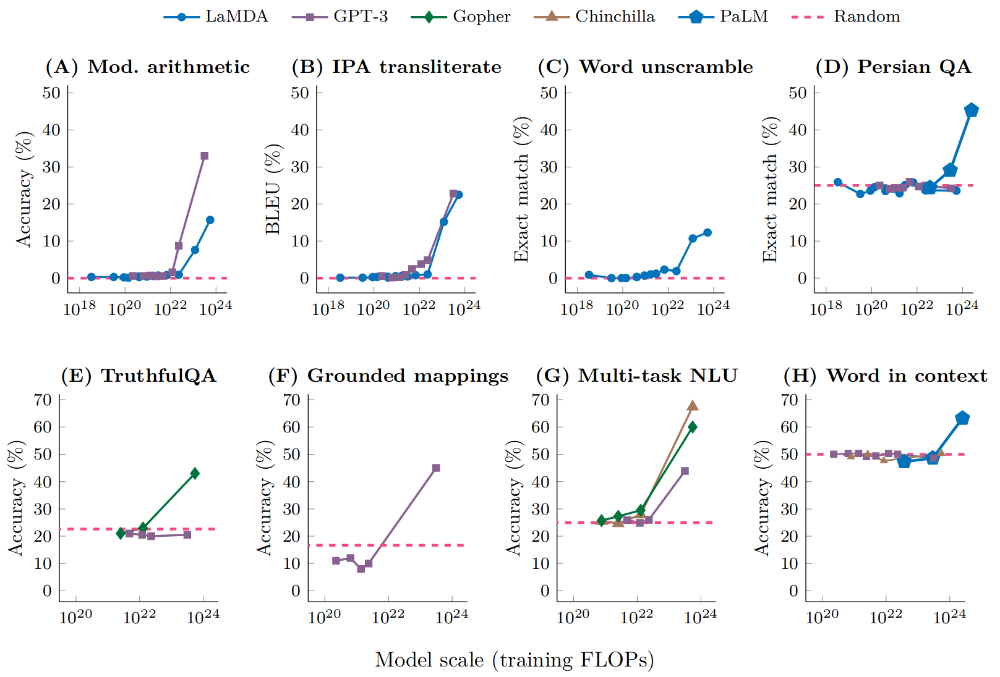

> [返回论文索引](../INDEX.MD) · [§3 少样本任务](../results/1-few-shot-tasks.md)

# 图 2 · 八个少样本实例（训练 FLOPs）

| 面板 | 任务 | 纵轴 |
|---|---|---|
| A | 改编算术 | Accuracy (%) |
| B | IPA 转写 | BLEU (%) |
| C | 字母重排 | Exact match (%) |
| D | 波斯语问答 | Exact match (%) |
| E | TruthfulQA | Accuracy (%) |
| F | Grounded mappings | Accuracy (%) |
| G | MMLU | Accuracy (%) |
| H | Word in Context | Accuracy (%) |

每个点对应一个模型，A–D 来自 BIG-Bench 的 2-shot 设置。源包用 PGFPlots 绘制：[原图源码与坐标](../../../TeX/Emergent/arXiv-2206.07682v2/emergent-few-shot-flops.tex) · [参数轴版本](figure-11-few-shot-params.md) · [已发表 PDF（图 2）](https://arxiv.org/pdf/2206.07682v2)。
