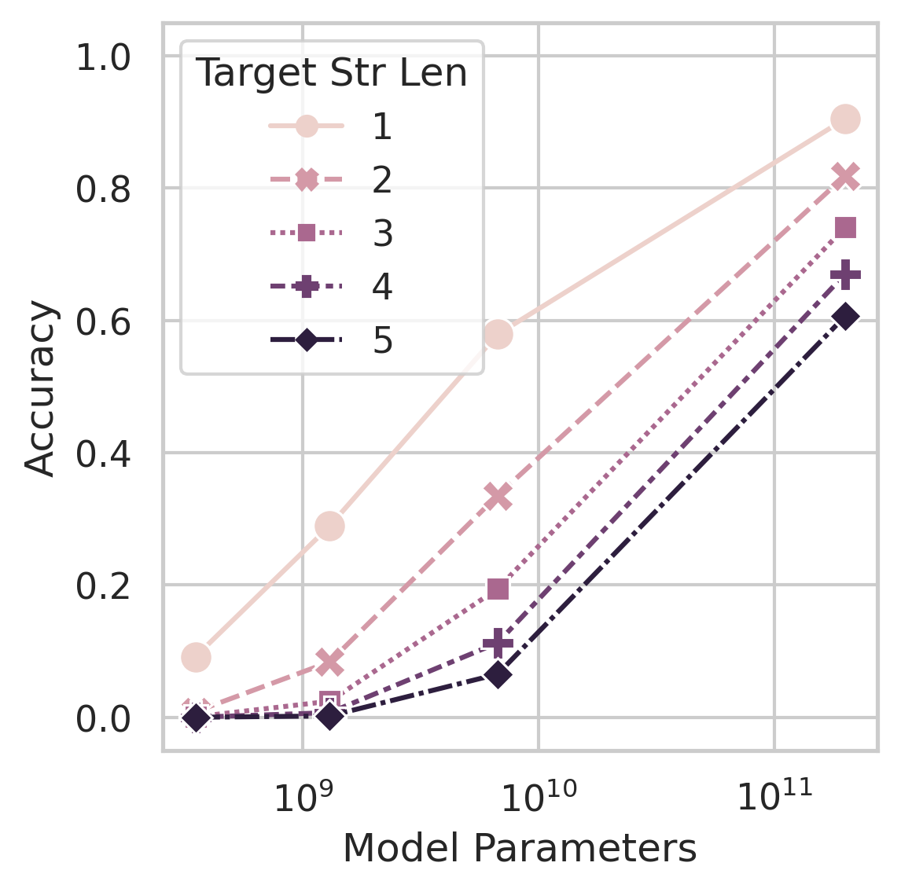
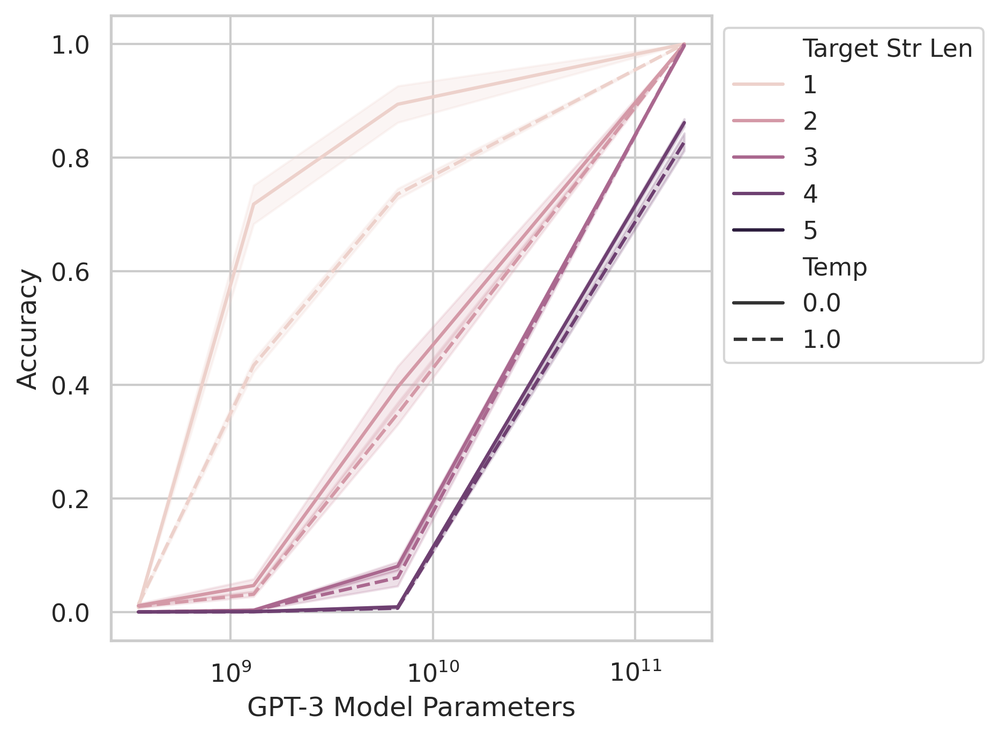
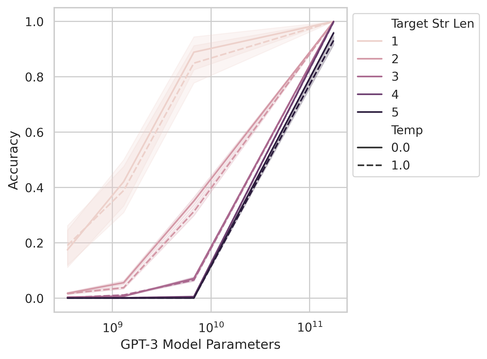
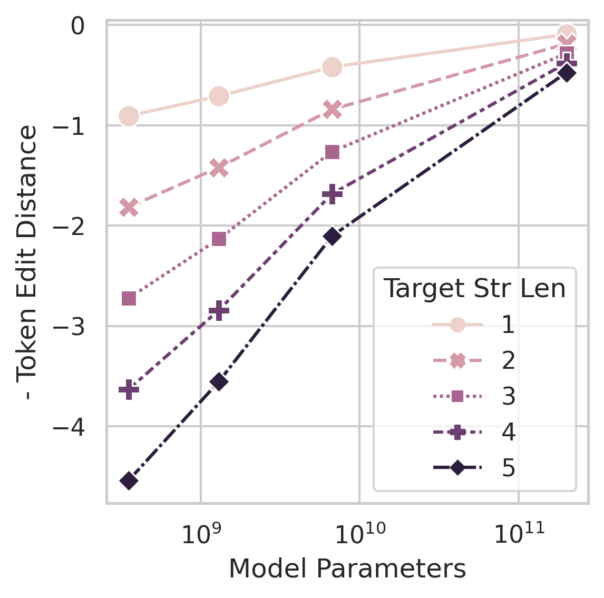
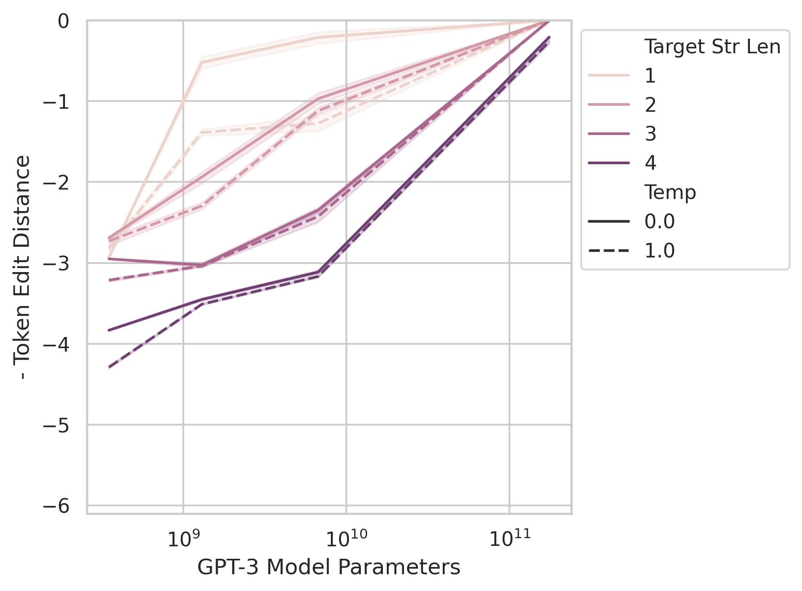
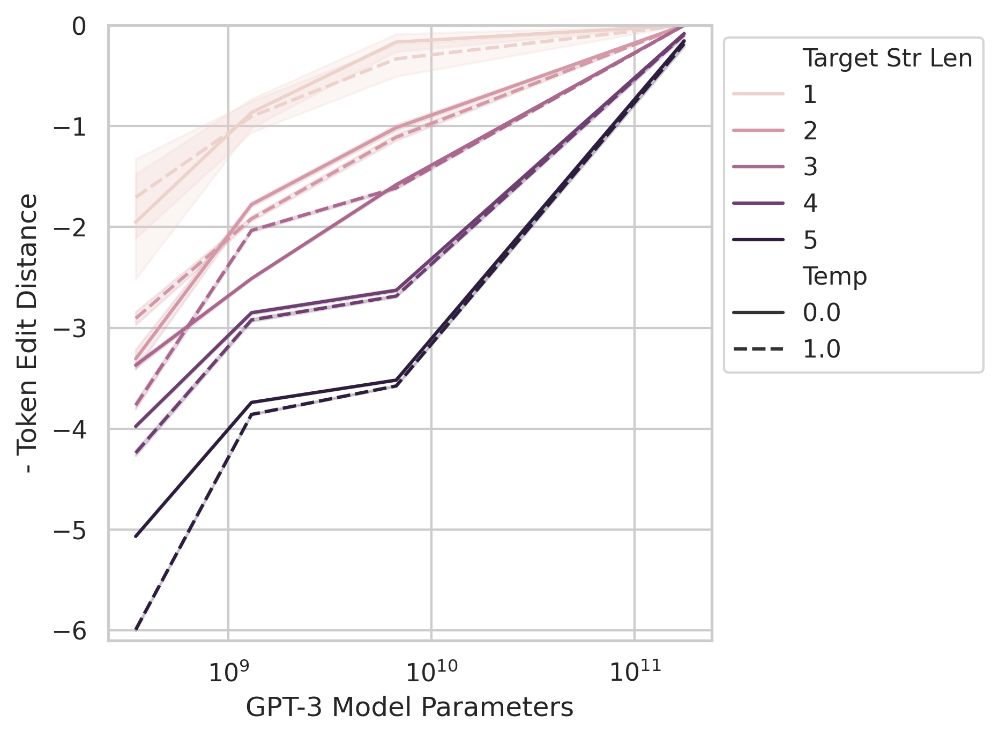

> [返回论文索引](../INDEX.MD) · [§3 算术重评分](../results/1-arithmetic-metric.md)

# 图 3 · 算术：同一输出换指标

从左至右为数学模型、两位数整数乘法、四位数整数加法；上排为准确率，下排为负 token 编辑距离。

| 数学模型 | 乘法 | 加法 |
|---|---|---|
|  |  |  |
|  |  |  |
