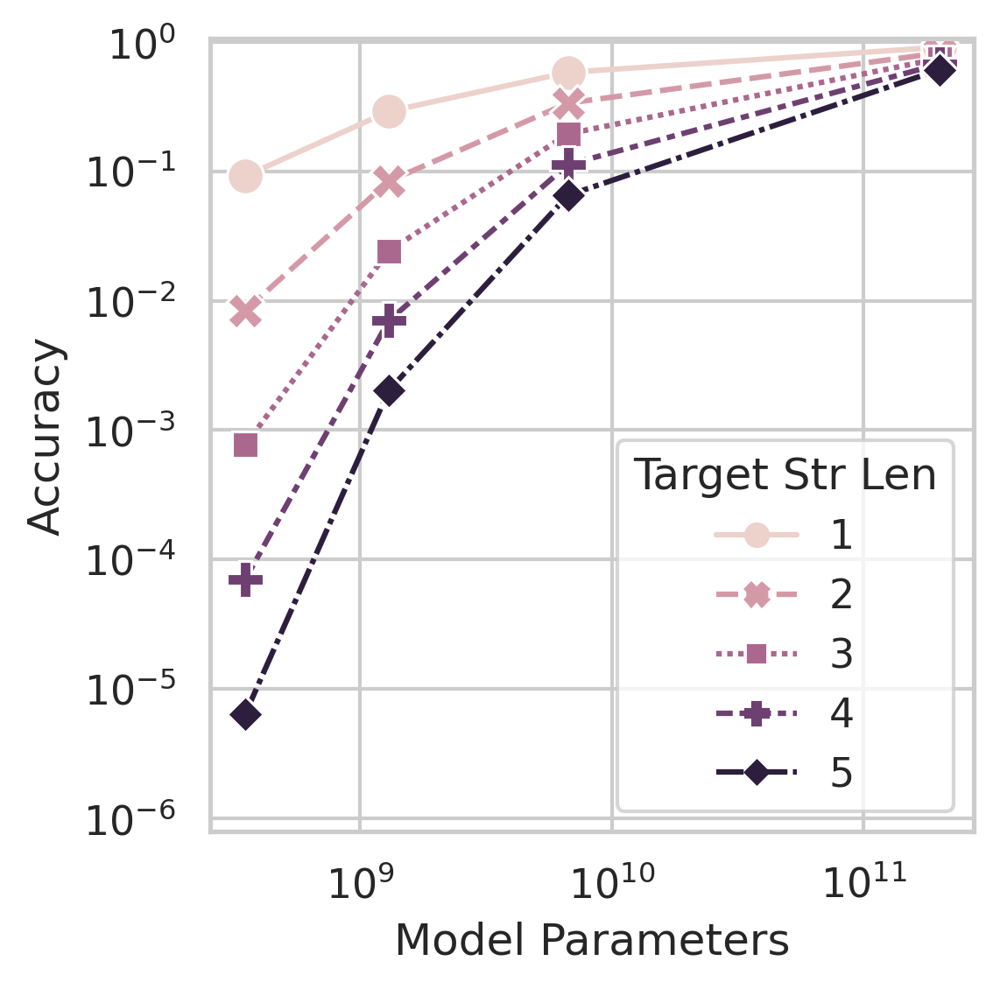
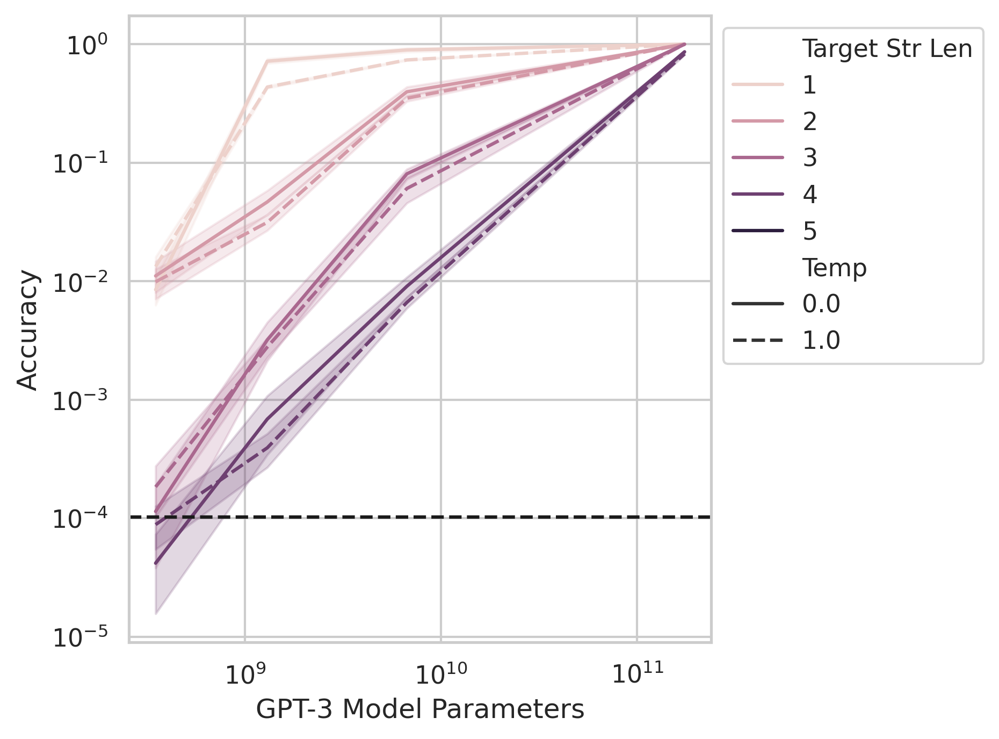
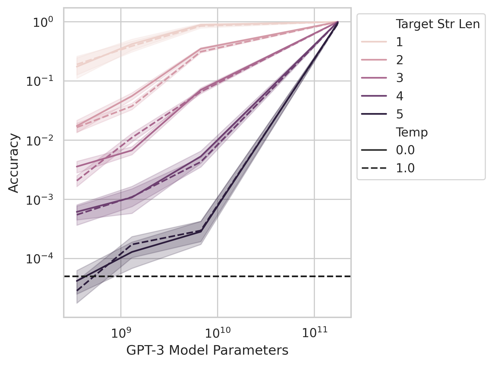

> [返回论文索引](../INDEX.MD) · [§3 测试分辨率](../results/2-arithmetic-resolution.md)

# 图 4 · 增加数据后，准确率曲线不再贴零

数学模型、两位数乘法、四位数加法（从左到右）。纵轴取对数；增加测试数据后分辨到小模型高于随机的准确率。

| 数学模型 | 乘法 | 加法 |
|---|---|---|
|  |  |  |
