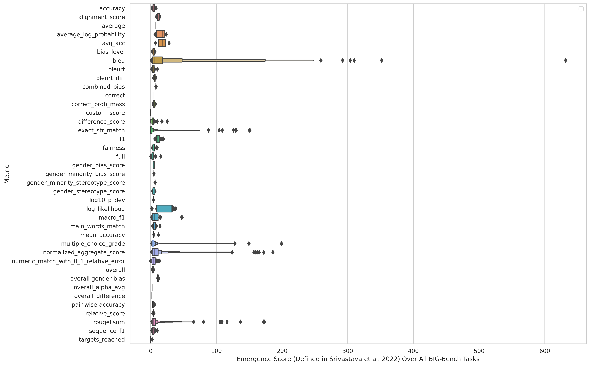
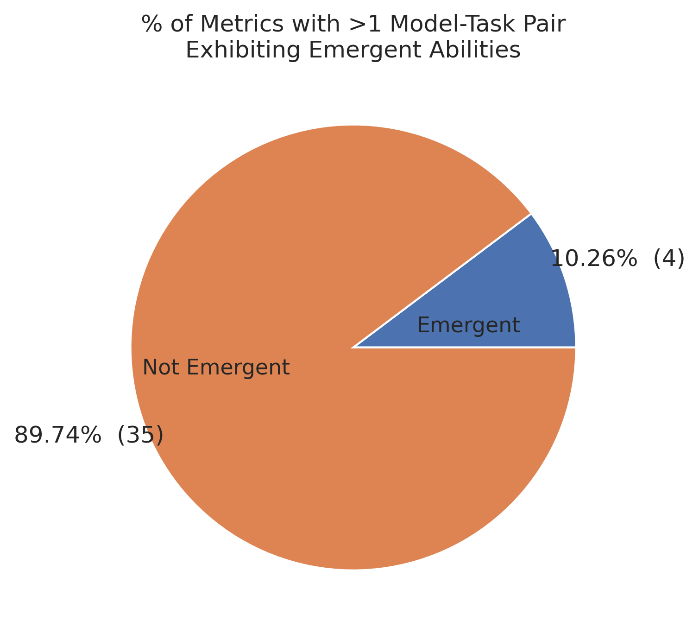
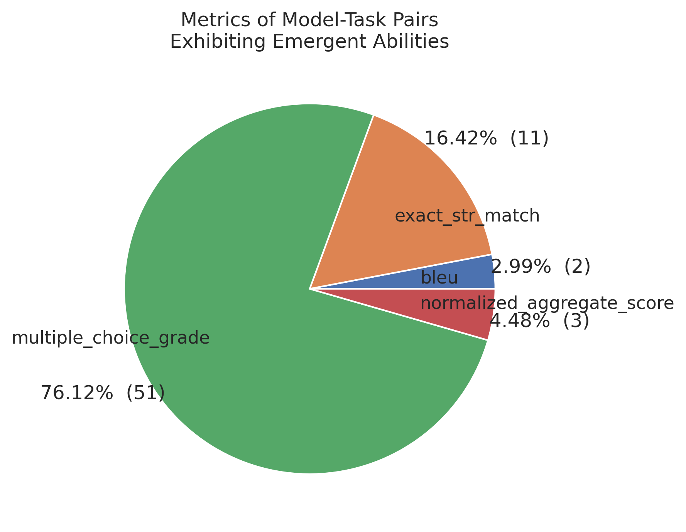

> [返回论文索引](../INDEX.MD) · [§4 BIG-Bench 分布](../results/3-big-bench-metrics.md)

# 图 5 · 涌现集中在少数评分指标

| B 人工标注 | C 已标涌现的指标构成 |
|---|---|
|  |  |

A：候选涌现最多涉及 5/39 种指标；B：人工标注涉及 4 种首选指标；C：超过 92% 集中在 Multiple Choice Grade 和 Exact String Match。
