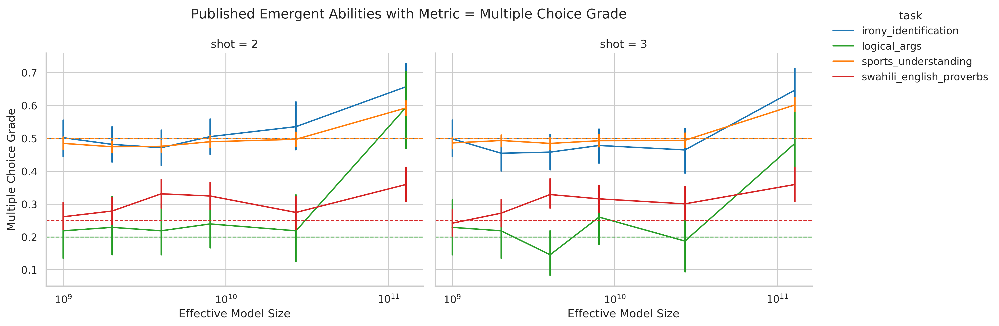
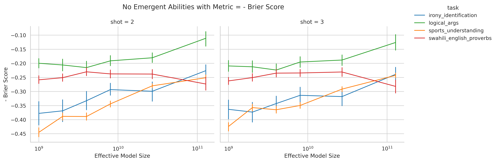

> [返回论文索引](../INDEX.MD) · [§4 LaMDA 重评分](../results/4-lamda-brier.md)

# 图 6 · LaMDA 硬选择分数与 Brier Score

| Multiple Choice Grade | Brier Score |
|---|---|
|  |  |

同一批任务和同一模型家族下，左图有选择题跃升，右图用连续评分不呈同样跃升。
