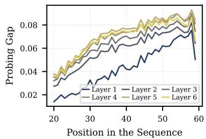

> [返回论文索引](../INDEX.MD) · [OthelloGPT](../results/2-othellogpt.md)

# 图 3 · 有用和无用棋格的探针差异与归因

右侧原始面板在源 Markdown 中为表格，给出累计影响的 95% 区间：

| 分量 | NTP-useful | NTP-useless |
|---|---:|---:|
| Direct | [2.85, 12.38] | [−4.69, 2.74] |
| Pre-cached | [−1.99, 0.66] | [0.55, 3.05] |
| Shared | [4.80, 12.48] | [2.93, 9.91] |
| Combined | [12.14, 19.05] | [4.42, 10.07] |
