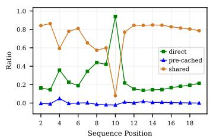
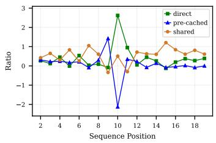
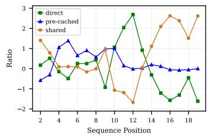

> [返回论文索引](../INDEX.MD) · [玩具任务](../results/1-toy-tasks.md) · [附录 E](../appendix/5-further-results.md)

# 图 8 · 玩具任务的归一化累计影响

面板依次为 Majority、参数共享的 Conditioned Majority，以及 10-untied 的 Conditioned Majority。
