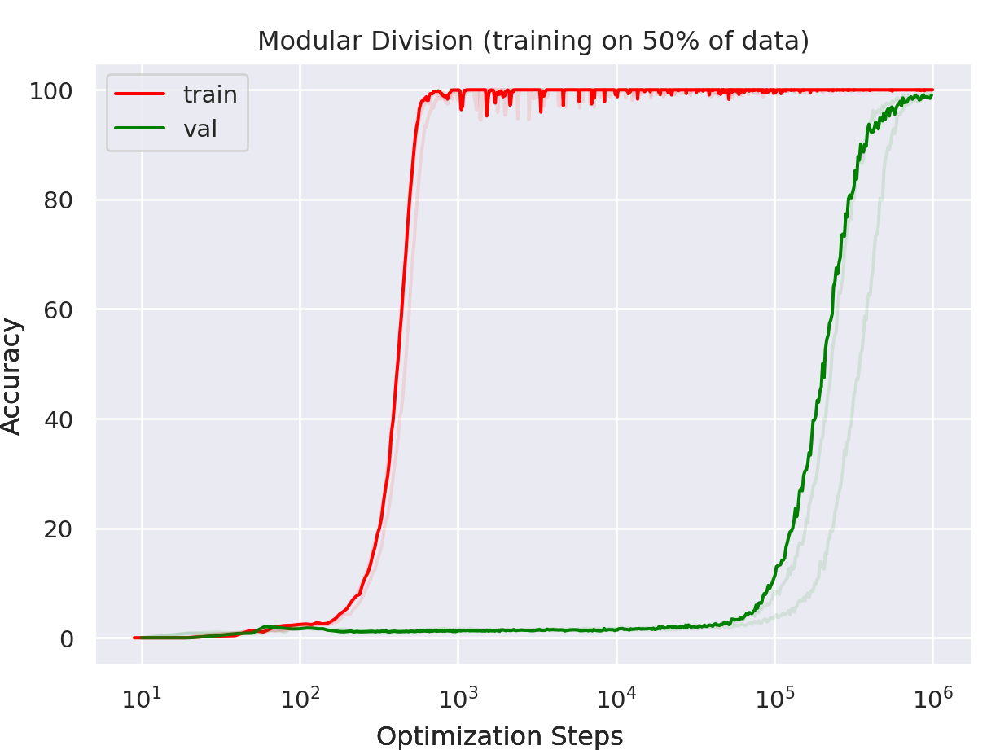
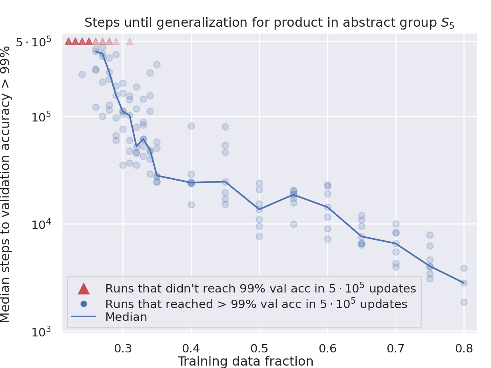
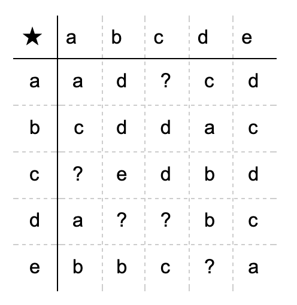

⬅️ 返回 [../INDEX.MD](../INDEX.MD) · 所属：§1、§3.1

# 图 1 · 模除法、学习时间与运算表

**图注：** 左：用模 97 除法运算表的 50% 训练，验证准确率接近 $10^6$ 步才达到近满分。中：$S_5$ 乘积中达到 99% 验证准确率的步数随训练数据减少快速增加。右：二元运算表的填空例子。

## 关联章节与图表

- [把泛化变成填运算表](../introduction/introduction.md)
- [二元运算任务与评估](../methods/1-binary-operation-task.md)
- [过拟合之后的延迟泛化](../results/1-generalization-beyond-overfitting.md)
- [训练数据越少，达到同一验证准确率越慢](../results/2-learning-time-curves.md)
