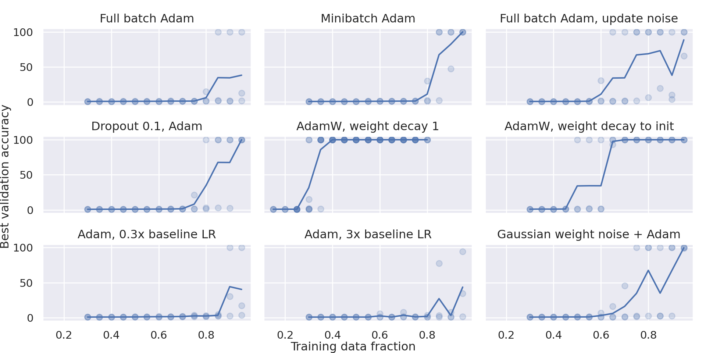
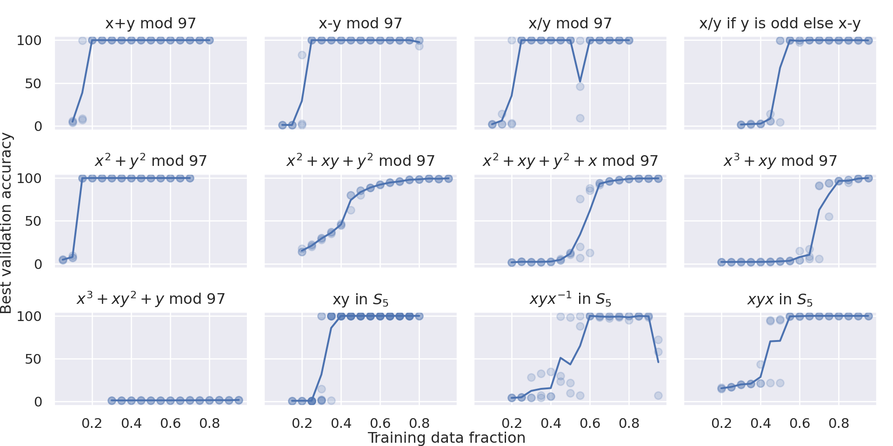

⬅️ 返回 [../INDEX.MD](../INDEX.MD) · 所属：§3.2–3.3

# 图 2 · 优化设置与运算种类

**图注：** 左：$S_5$ 乘积的优化器和正则化消融，预算为 $10^5$ 步。右：不同运算在给定预算内的最佳验证准确率，对 3 个随机种子取平均。

## 关联章节与图表

- [运算结构与泛化](../results/3-variety-of-operations.md)
- [优化器与正则化消融](../results/4-ablations-and-tricks.md)
- [测试的二元运算](../tables/table-1-binary-operations.md)
- [模型和训练超参数](../tables/table-2-training-configuration.md)
