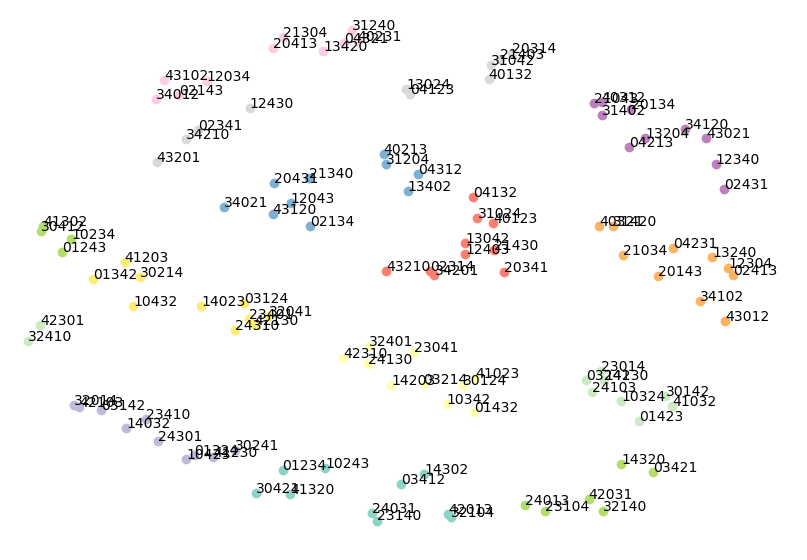
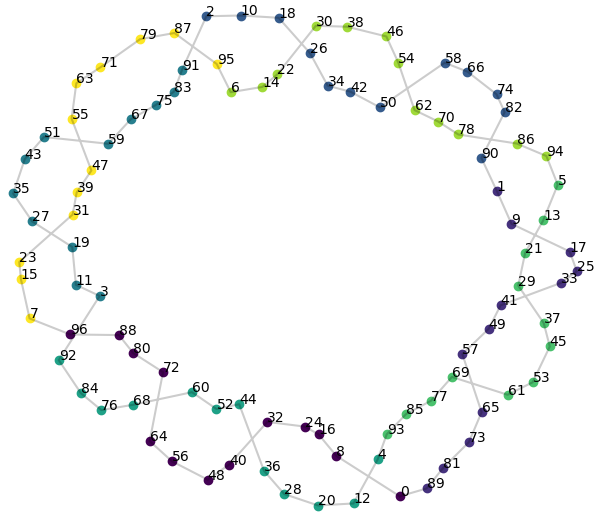

⬅️ 返回 [../INDEX.MD](../INDEX.MD) · 所属：§3.4

# 图 3 · 输出层权重的 t-SNE

**图注：** 左：$S_5$ 置换的簇对应子群（或共轭子群）的陪集。右：模加法中的线段连接「加 8」前后的点，颜色表示模 8 的余数。

## 关联章节与图表

- [输出层权重的 t-SNE 可视化](../results/5-embedding-visualization.md)
