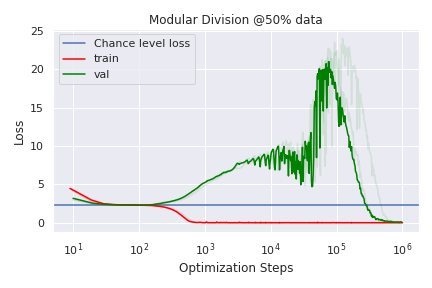

⬅️ 返回 [../INDEX.MD](../INDEX.MD) · 所属：附录 A.2

# 图 4 · 模除法训练和验证损失

**图注：** 验证损失从约 $10^2$ 步上升到约 $10^5$ 步，随后开始二次下降。

## 关联章节与图表

- [过拟合之后的延迟泛化](../results/1-generalization-beyond-overfitting.md)
- [验证损失的二次下降](../results/6-validation-loss.md)
