# 01 · 在小型算法数据集上发现 Grokking

[返回总览](../INDEX.MD) · [实验附录](#appendix) · [下一篇：机制与进度指标](../02/INDEX.MD)

**原论文：** *Grokking: Generalization Beyond Overfitting on Small Algorithmic Datasets* — Alethea Power、Yuri Burda、Harri Edwards、Igor Babuschkin、Vedant Misra（2022）。

## 一分钟读懂

让 Transformer 看一张**只填了一部分的运算表**。输入是两个抽象符号，目标是预测它们的运算结果。模型可以先把已知格子背下来，长时间填不出空白格子，之后才学会对几乎所有未见组合给出正确结果。论文把这种延迟泛化称为 grokking。

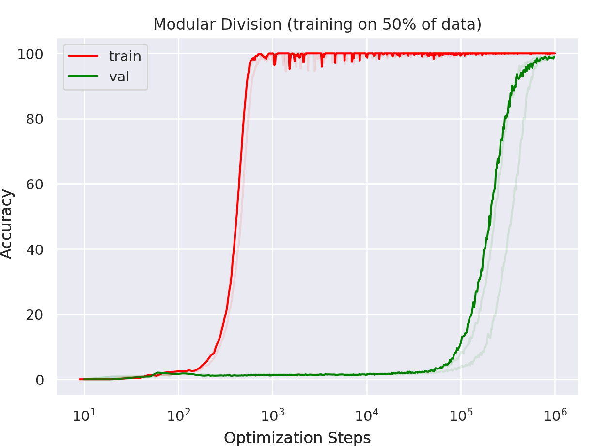

**原图 1 左：** 用模 97 除法运算表的 50% 训练。训练准确率在不到 $10^3$ 次更新时已接近满分；验证集约到 $10^5$ 步才出现明显泛化，接近 $10^6$ 步达到类似准确率。这组用于突出延迟的实验采用 Adam，不使用权重衰减。

## 展开正文

§1–2 · 任务为什么像填数独？

每条数据是 $a\circ b=c$。$a$、运算符、$b$、等号、$c$ 各是一个 token，损失和准确率只看答案。对同一运算，随机抽取一定比例的等式作为训练集，其余全部作为验证集。训练和验证共享符号词表，但没有相同的输入对。数字没有十进制表示，置换也没有显式的排列结构；模型只能通过符号之间的关系学运算。

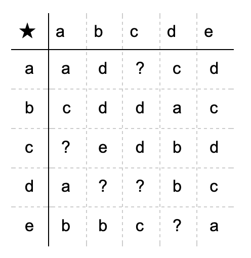

**原图 1 右：** 给一部分格子的值，猜剩下的格子。所有实验采用两层 decoder-only Transformer；完整任务表、训练预算和优化器参数见[实验附录](#appendix)。

§3.1 · 过拟合之后为什么还要继续训练？

典型的模除法案例不只出现准确率跃升：验证损失先升高，约到 $10^5$ 步才开始二次下降。同种现象在接近「给定预算内仍能泛化」的最小数据量附近尤其明显；数据较多时，训练和验证曲线更接近。

在 $S_5$ 置换群乘积任务中，训练集占比约为 25%–30% 时，占比少 **1 个百分点**，达到 99% 验证准确率所需步数的中位数约增加 40%–50%。而训练准确率首次达到 99% 通常只需 $10^3$–$10^4$ 步，且数据越少反而往往越早达到。于是，在一段数据量范围内，数据更少并不降低最终准确率，却显著增加达到同一准确率的计算成本。

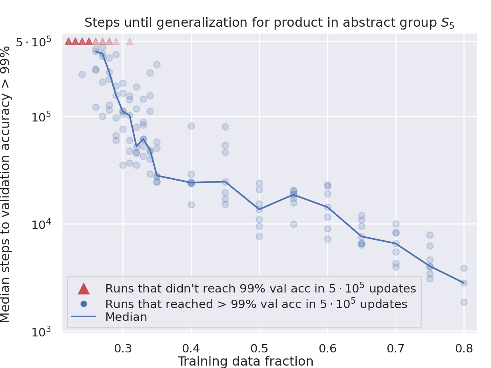

§3.2–3.3 · 哪些运算和优化设置更有利于泛化？

- **重新命名不改变任务。** 对质数 $p$，非零模 $p$ 剩余类可写成原根的幂。于是非零元素的模 $p$ 乘法与模 $p-1$ 加法只差符号重命名；除法与减法同理。对没有预置符号含义的模型，两类任务需要的数据量也相近。
- **对称性可能有用。** 加法等交换运算通常比相关的非交换运算需要更少数据；作者提出这可能部分来自架构，因为 Transformer 可以忽略位置嵌入来实现对称函数。复杂的 $x^3+xy^2+y\pmod{97}$ 即使给到 95% 的训练数据，也未在给定预算内泛化。另一方面，按 $y$ 奇偶在模除法与模减法之间切换的混合运算也可以泛化。
- **权重衰减在 $S_5$ 乘积上最有效。** 在 $10^5$ 步预算下，相比多数干预，向零衰减可把所需样本量降到一半以下；向初始化值衰减也有帮助，但效果稍弱。小批量训练和某些噪声干预有益，学习率偏离合适范围也会严重影响泛化。

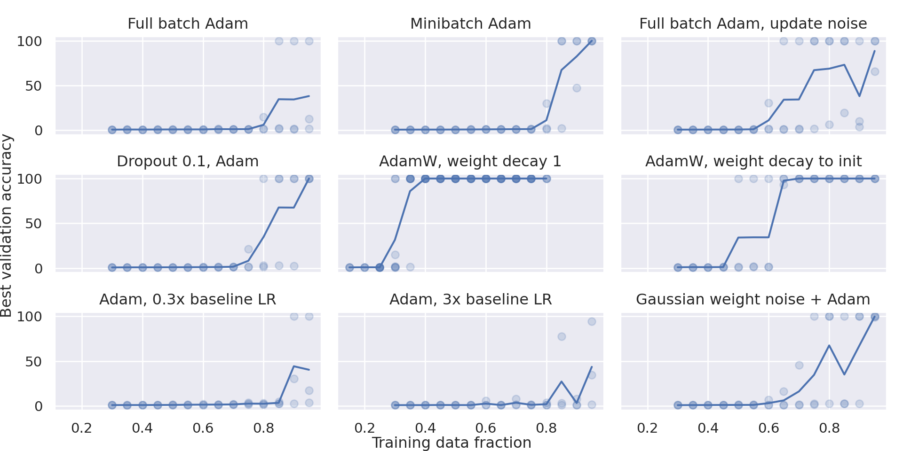

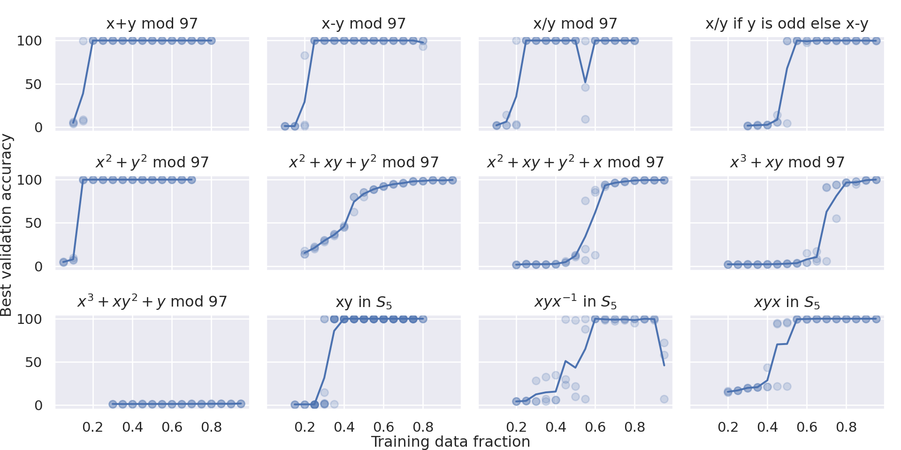

§3.4–4 · 模型学到的表示里有什么？

作者对**输出层权重**按行做 t-SNE。模加法的表示出现环状结构，图中线段连接「加 8」前后的点；$S_5$ 中一些置换形成簇，对应于某个子群或其共轭子群的陪集。这样的结构在使用权重衰减的模型中更明显。投影能提示结构，但不能单凭图形确定模型如何计算答案。

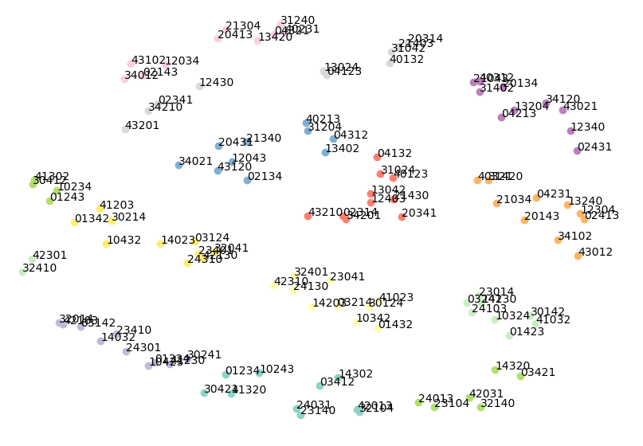

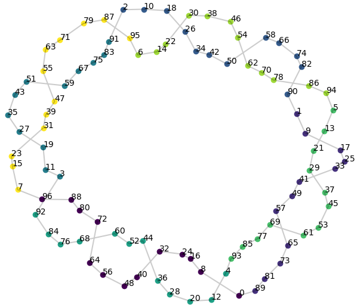

论文提出两个后续问题：是否可以用更多计算来弥补其他任务中的训练数据不足？损失地形的平坦度能否预测延迟泛化？后者在[附录](#appendix)里有初步相关性结果。

## 原文和参考文献

[arXiv v1](https://arxiv.org/abs/2201.02177v1) · [论文 PDF](https://arxiv.org/pdf/2201.02177v1) · [本地 TeX](../../TeX/Grokking/arXiv-2201.02177v1/main.tex) · [原论文参考文献清单](references/references.md) · [BibTeX](../../TeX/Grokking/arXiv-2201.02177v1/main.bib)

---

# 01 附录 · 运算表、超参数与补充实验

[返回论文导读](INDEX.MD) · [返回总览](../INDEX.MD)

附录回答三个问题：实验怎么搭，记住错标签是否妨碍泛化，以及损失地形的平坦度是否与泛化相关。

附录 A.1 · 运算清单与训练配置

默认 $p=97$。除注明外，模运算的两个输入都在 $0,\ldots,p-1$。$S_5$ 是 5 个元素的置换群。

| 类别 | 论文测试的运算 |
| --- | --- |
| 基本模运算 | $x+y$、$x-y$、$x/y$（要求 $y\ne 0$） |
| 分段运算 | $y$ 为奇数时 $x/y\pmod p$，否则 $x-y\pmod p$ |
| 模多项式 | $x^2+y^2$、$x^2+xy+y^2$、$x^2+xy+y^2+x$、$x^3+xy$、$x^3+xy^2+y$ |
| 置换运算 | $xy$、$xyx^{-1}$、$xyx$（$x,y\in S_5$） |

| 项目 | 默认设置 |
| --- | --- |
| 模型 | 2 层 decoder-only Transformer，宽 128，4 个注意力头，因果掩码；约 $4\times 10^5$ 个非嵌入参数 |
| 训练 | 随机选一定比例的等式训练，其余验证；只在答案 token 上计损失和准确率 |
| AdamW | 学习率 $10^{-3}$，权重衰减 1，$\beta_1=0.9$，$\beta_2=0.98$ |
| 学习率与批量 | 前 10 次更新线性 warmup，后续不退火；批量取 512 与训练集一半中较小者 |
| 预算与随机种子 | 默认 $10^5$ 步，每个数据比例 3 个种子；学习时间实验 $5\times 10^5$ 步、7 个种子；模除法示例用无权重衰减的 Adam，预算 $10^6$ 步 |

消融比较了全批量 Adam、普通 Adam、全批量 Adam 加高斯更新噪声、残差 dropout 0.1、向零衰减、向初始化值衰减、学习率 $3\times10^{-4}$ 或 $3\times10^{-3}$，以及训练时给权重加标准差 0.01 的高斯噪声。

附录 A.2–A.3 · 补充图与相关工作

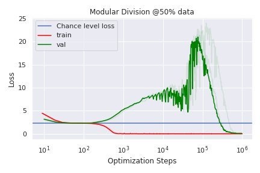

验证损失在约 $10^2$–$10^5$ 步之间上升，之后才开始第二次下降。论文指出：这一现象发生在训练集早已被插值之后，且准确率并未呈现相同的非单调变化，因此不宜简单等同于围绕插值阈值出现的双下降。以算法任务为基准的既有工作多考察不限数据时的表现或长度泛化，而本研究关心有限数据下、完全拟合之后的训练动态。梯度噪声研究也曾观察到类似的曲线，但其侧重点是优化难度。

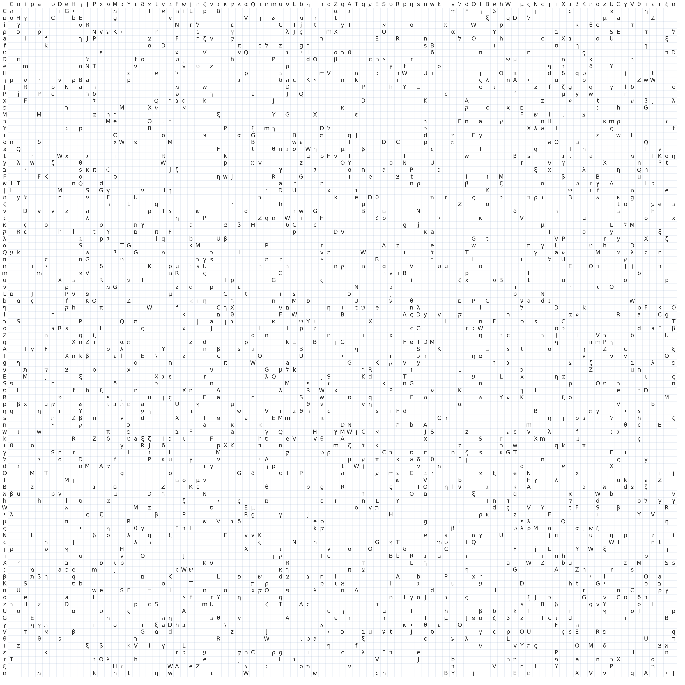

附录 A.4 · 可以一边记住错标签，一边正确泛化吗？

对 $k\in\{0,10,100,1000,2000,3000\}$ 个训练等式，用随机抽取的其他训练等式的答案替换原答案，验证集不改。可能的结果包括：忽略错误标签而无法拟合整个训练集，或者记下错误标签但损害泛化。实验中每组都曾达到 100% 训练准确率，说明模型能记下这些异常。较少的异常对泛化影响不明显；异常增多会缩小能在预算内泛化的数据比例范围。

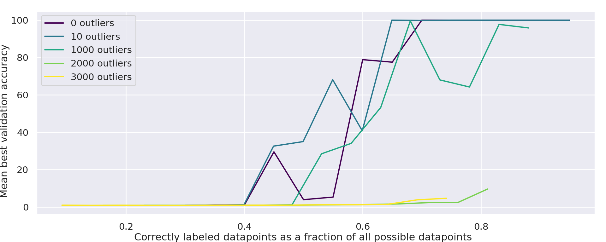

附录 A.5 · 平坦度是线索，不是因果结论

在 $S_5$ 置换复合任务中，作者取不同初始化、以相同预算训练的模型，对比验证准确率与极小值的尖锐度估计 $\phi$。两者 Spearman 相关系数是 $-0.79548$，且 $p<0.000014$。结果提示更高验证准确率与更平坦的区域相关；单个任务的相关性不能确定平坦度导致了 grokking。

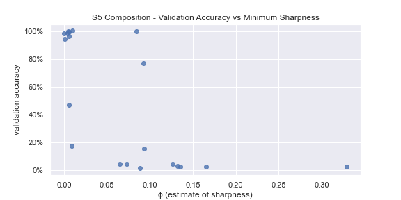

[原论文附录（PDF）](https://arxiv.org/pdf/2201.02177v1) · [本地 TeX](../../TeX/Grokking/arXiv-2201.02177v1/main.tex)
