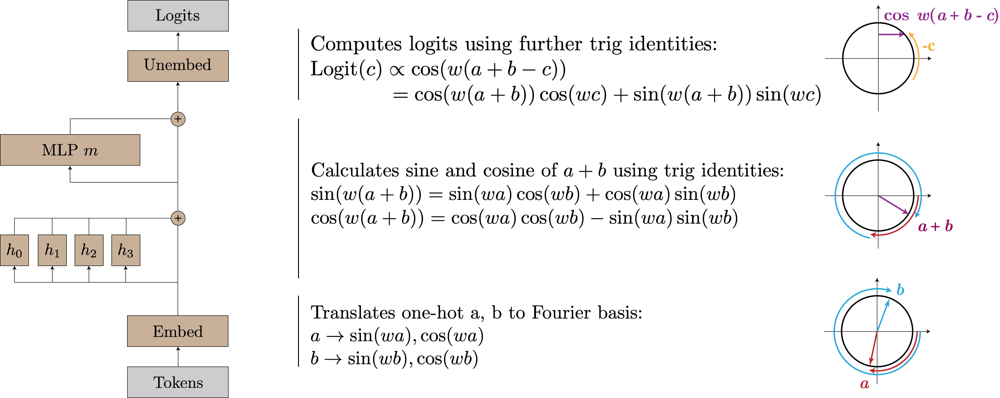

⬅️ 返回 [../INDEX.MD](../INDEX.MD) · 所属：§1、§3.1

# 图 1 · 模加法的傅里叶乘法电路

**图注：** 将 $a$、$b$ 映射为旋转，组合后得到 $a+b$ 的表示，再对每个候选 $c$ 读取 $\cos(w(a+b-c))$。

## 关联章节与图表

- [怎样看见准确率跃升之前的学习进展？](../introduction/introduction.md)
- [用旋转计算模加法](../methods/2-fourier-multiplication.md)
