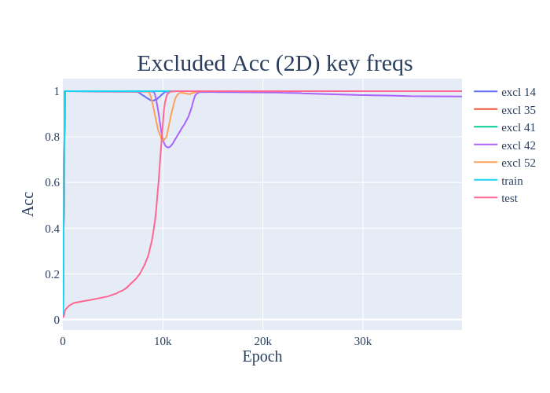
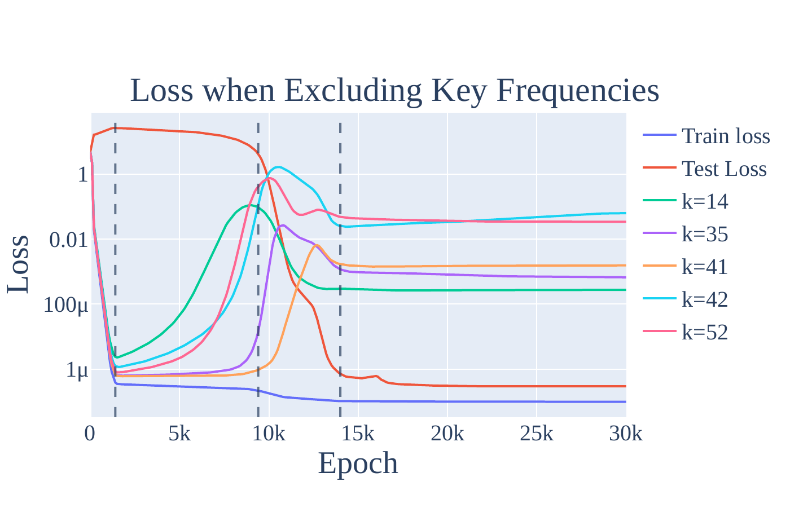

⬅️ 返回 [../INDEX.MD](../INDEX.MD) · 所属：附录 C.1

# 图 15 · 逐一排除关键频率的准确率与损失

[原始 PDF 图](../images/excluded_loss_2D_key.pdf)

**图注：** 左：逐一排除五个关键频率之一后的训练准确率；右：相应的排除损失。

## 关联章节与图表

- [记忆、电路形成与清理](../results/6-training-phases.md)
