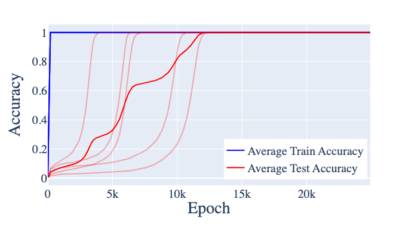
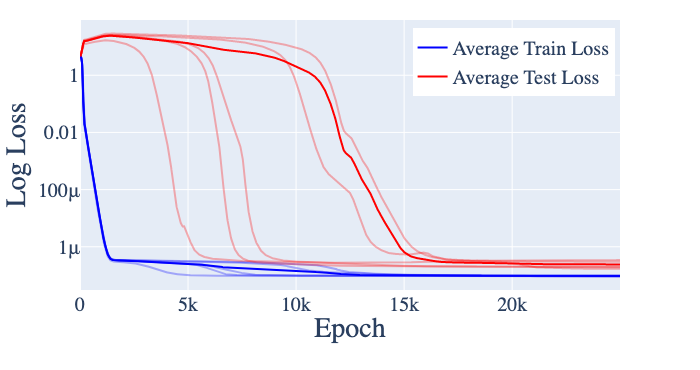

⬅️ 返回 [../INDEX.MD](../INDEX.MD) · 所属：§3

# 图 2 · 主实验的准确率和损失

**图注：** 左：训练和测试准确率；右：训练和测试损失。展示五个随机种子。

## 关联章节与图表

- [主实验的训练与测试曲线](../results/1-baseline-grokking.md)
- [模 113 加法的主实验设置](../methods/1-experimental-setup.md)
