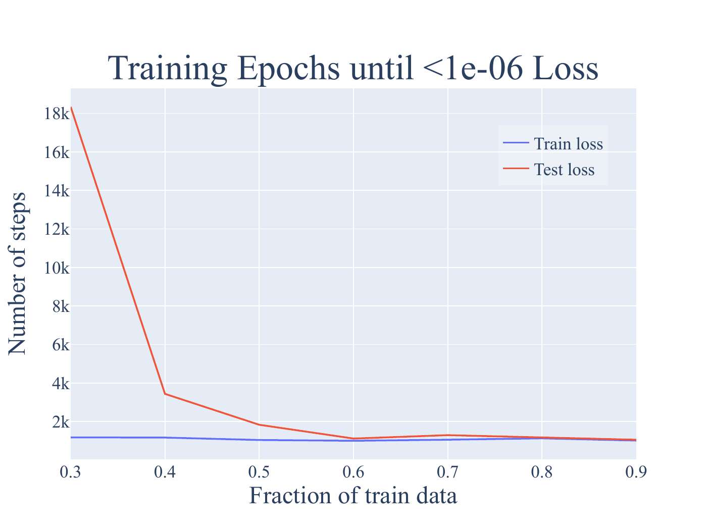

⬅️ 返回 [../INDEX.MD](../INDEX.MD) · 所属：附录 C.2

# 图 21 · 训练数据比例与收敛步数

[原始 PDF 图](../images/appendix-only/steps_to_convergence.pdf)

**图注：** 纵轴为训练或测试损失降到 $10^{-6}$ 以下的步数。数据较少时，测试损失达到阈值所需的步数显著增加。

## 关联章节与图表

- [种子、样本占比、深度和模数的对照](../results/10-other-training-runs.md)
- [不同实验条件下的泛化](../tables/table-6-cross-run-comparisons.md)
