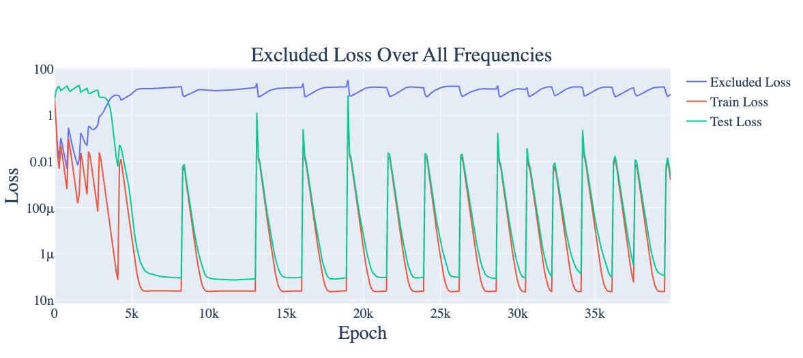

⬅️ 返回 [../INDEX.MD](../INDEX.MD) · 所属：附录 C.2

# 图 23 · 两层模型的排除损失

**图注：** 展示两层 Transformer 在一个随机种子下的训练损失、测试损失和排除损失。

## 关联章节与图表

- [种子、样本占比、深度和模数的对照](../results/10-other-training-runs.md)
- [Slingshot 不是延迟泛化的必要步骤](../results/12-slingshot.md)
- [不同实验条件下的泛化](../tables/table-6-cross-run-comparisons.md)
