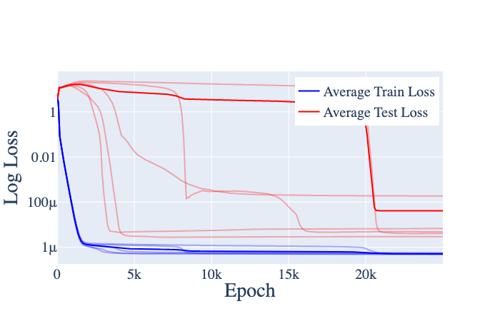

⬅️ 返回 [../INDEX.MD](../INDEX.MD) · 所属：附录 C.2

# 图 24 · 模 53 加法曲线

**图注：** 权重衰减系数提高到 5 时观察到延迟泛化。粗线为平均曲线。

## 关联章节与图表

- [种子、样本占比、深度和模数的对照](../results/10-other-training-runs.md)
- [不同实验条件下的泛化](../tables/table-6-cross-run-comparisons.md)
