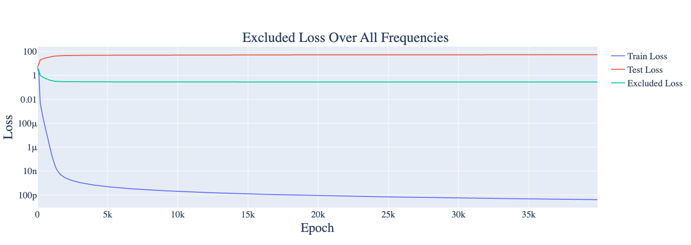

⬅️ 返回 [../INDEX.MD](../INDEX.MD) · 所属：附录 D.1

# 图 26 · 去掉权重衰减的对照

**图注：** 单层主架构的一次运行；排除损失没有上升，也没有出现延迟泛化。

## 关联章节与图表

- [权重衰减和训练数据量的作用](../results/7-weight-decay.md)
- [权重衰减、dropout 与 L1 惩罚的对照](../results/11-regularization-controls.md)
