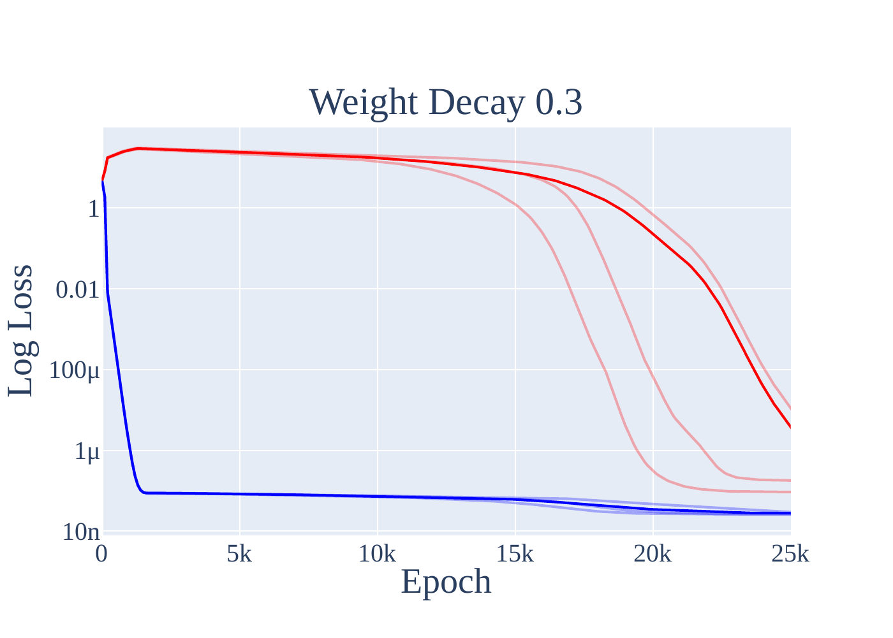
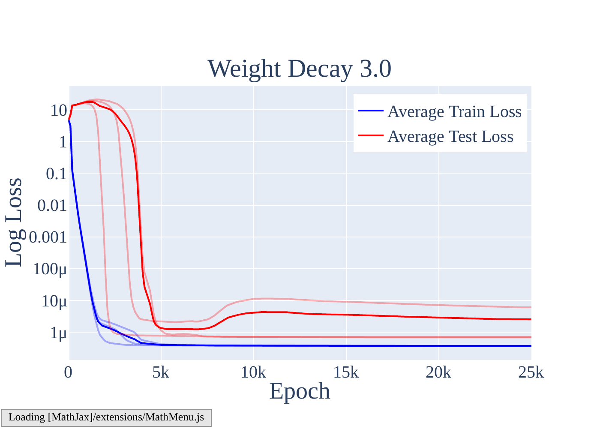

⬅️ 返回 [../INDEX.MD](../INDEX.MD) · 所属：附录 D.1

# 图 27 · 两种权重衰减强度的对照

[原始 PDF 图](../images/appendix-only/1l-grokking-weight-decay-03.pdf)

[原始 PDF 图](../images/appendix-only/1l-grokking-weight-decay-3.pdf)

**图注：** 左：$\lambda=0.3$；右：$\lambda=3.0$。原文附录 D.1 对步数的叙述和图注不一致，正文不采用该组叙述作定量比较。

## 关联章节与图表

- [权重衰减、dropout 与 L1 惩罚的对照](../results/11-regularization-controls.md)
