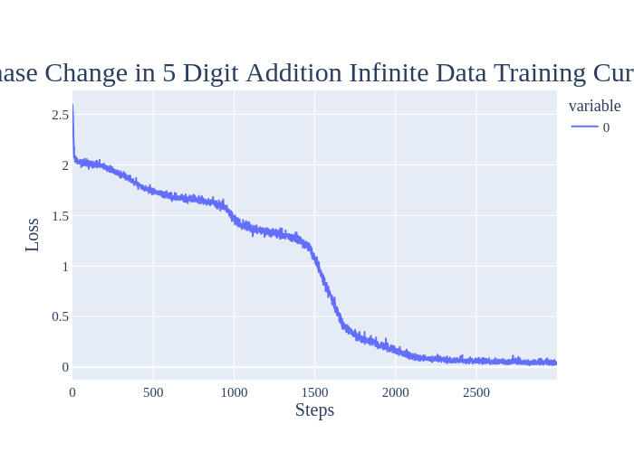
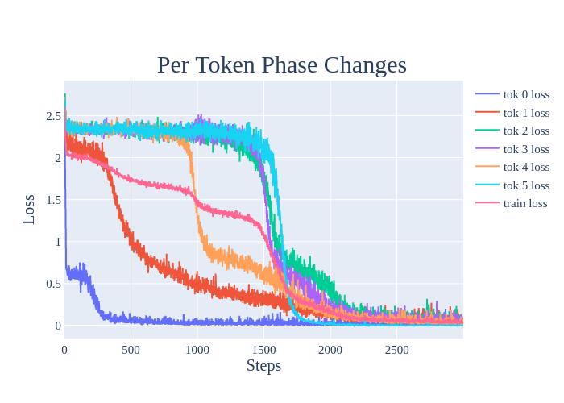

⬅️ 返回 [../INDEX.MD](../INDEX.MD) · 所属：附录 D.3

# 图 29 · 五位数加法：每步重采样

**图注：** 上：总训练与测试损失基本重合。下：各输出位在不同时间发生改善，部分跃升会被总损失掩盖。

## 关联章节与图表

- [三个算法任务的有限数据对照](../results/13-other-algorithmic-tasks.md)
- [每步重采样与固定数据的对照](../tables/table-7-finite-data-tasks.md)
