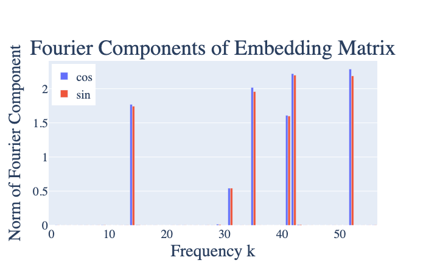
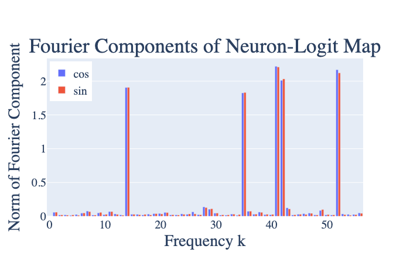

⬅️ 返回 [../INDEX.MD](../INDEX.MD) · 所属：§4.1

# 图 3 · 嵌入与读出权重的频域分量

**图注：** 左：$W_E$ 在傅里叶基底上的分量范数；右：从 MLP 激活到 logits 的映射 $W_L$ 的读出方向范数。

## 关联章节与图表

- [嵌入、激活和 logits 的周期性](../results/2-periodicity.md)
- [读出模型权重里的三角恒等式](../results/3-composing-model-weights.md)
- [表 1 · MLP 激活在关键读出方向的傅里叶分量](../tables/table-1-mlp-fourier-projections.md)
