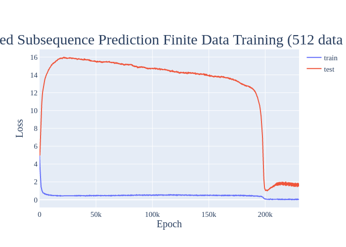

⬅️ 返回 [../INDEX.MD](../INDEX.MD) · 所属：附录 D.3

# 图 32 · 重复子序列：固定数据

**图注：** 固定 512 个样本后，训练与测试发生明显分离，之后测试损失才跃降。

## 关联章节与图表

- [三个算法任务的有限数据对照](../results/13-other-algorithmic-tasks.md)
- [每步重采样与固定数据的对照](../tables/table-7-finite-data-tasks.md)
