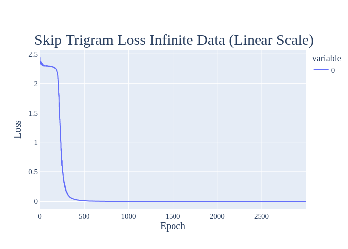

⬅️ 返回 [../INDEX.MD](../INDEX.MD) · 所属：附录 D.3

# 图 33 · Skip trigram：每步重采样

**图注：** 训练损失与测试损失重合；损失跃降与模型学会全部 skip trigram 对应。

## 关联章节与图表

- [三个算法任务的有限数据对照](../results/13-other-algorithmic-tasks.md)
- [每步重采样与固定数据的对照](../tables/table-7-finite-data-tasks.md)
