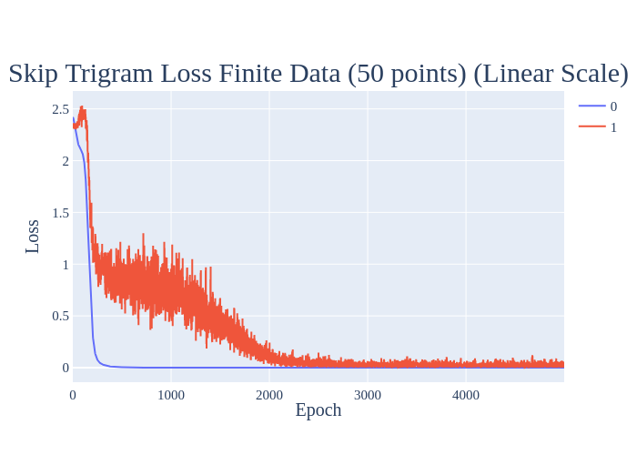

⬅️ 返回 [../INDEX.MD](../INDEX.MD) · 所属：附录 D.3

# 图 34 · Skip trigram：固定数据

**图注：** 固定 512 个训练样本后，出现明显的训练—测试损失分离以及随后的跃降。

## 关联章节与图表

- [三个算法任务的有限数据对照](../results/13-other-algorithmic-tasks.md)
- [每步重采样与固定数据的对照](../tables/table-7-finite-data-tasks.md)
