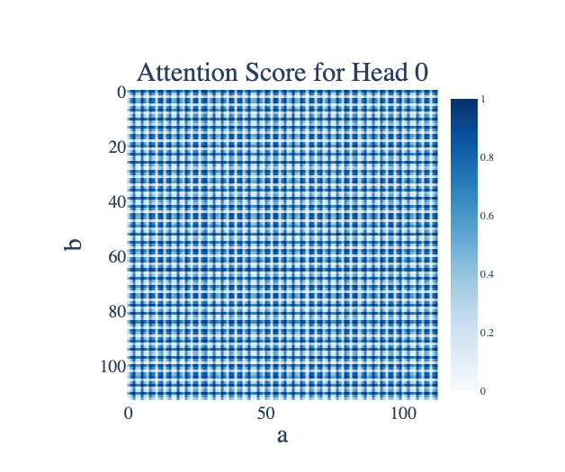
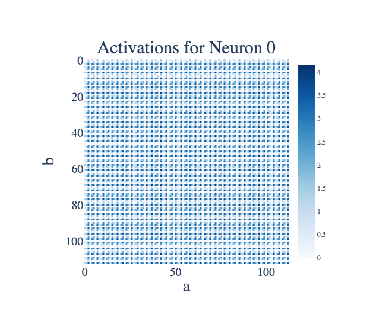
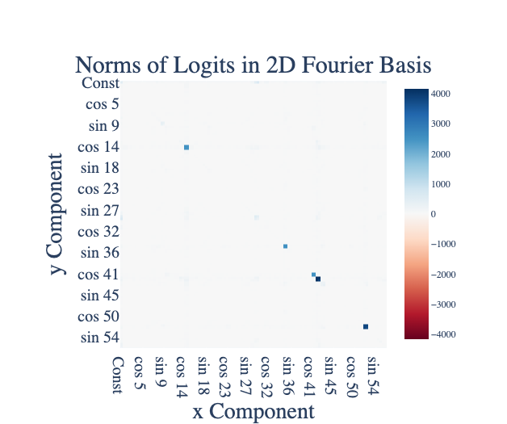

⬅️ 返回 [../INDEX.MD](../INDEX.MD) · 所属：§4.1

# 图 4 · 注意力分数、MLP 激活与 logits 的周期性

**图注：** 左：注意力头 0 从 `=` 到输入 $a$ 的分数；中：MLP 神经元 0 的激活；右：logits 在傅里叶基底中的分量范数。

## 关联章节与图表

- [嵌入、激活和 logits 的周期性](../results/2-periodicity.md)
- [用单频二次多项式拟合神经元](../results/4-fitting-neuron-activations.md)
