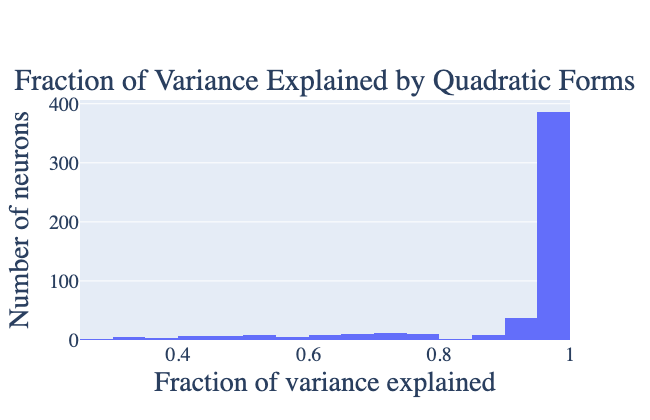
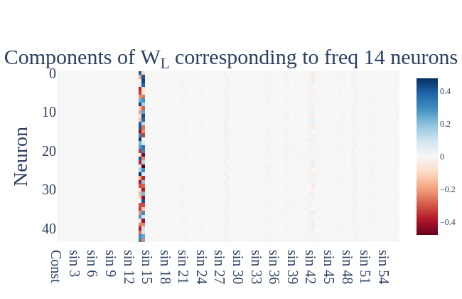

⬅️ 返回 [../INDEX.MD](../INDEX.MD) · 所属：§4.3

# 图 5 · 神经元的频率拟合及对 logits 的贡献

**图注：** 左：逐个神经元的最佳单频二次多项式拟合。右：拟合频率为 14 的神经元对读出频率的贡献。

## 关联章节与图表

- [用单频二次多项式拟合神经元](../results/4-fitting-neuron-activations.md)
