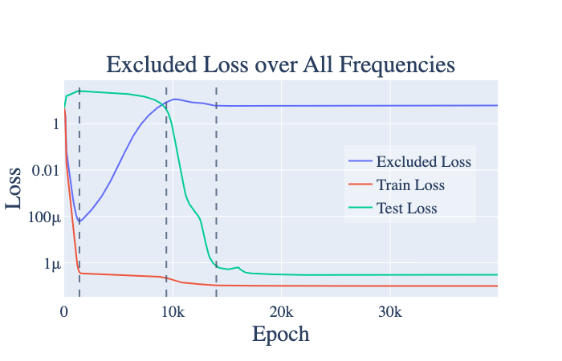
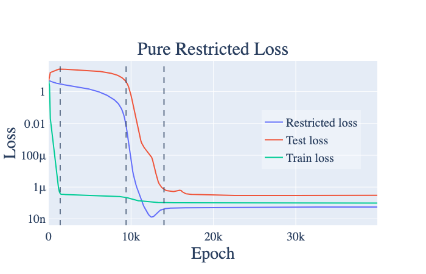
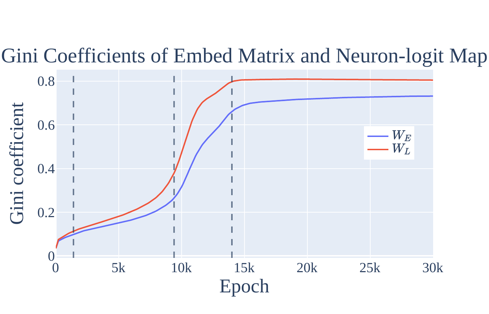
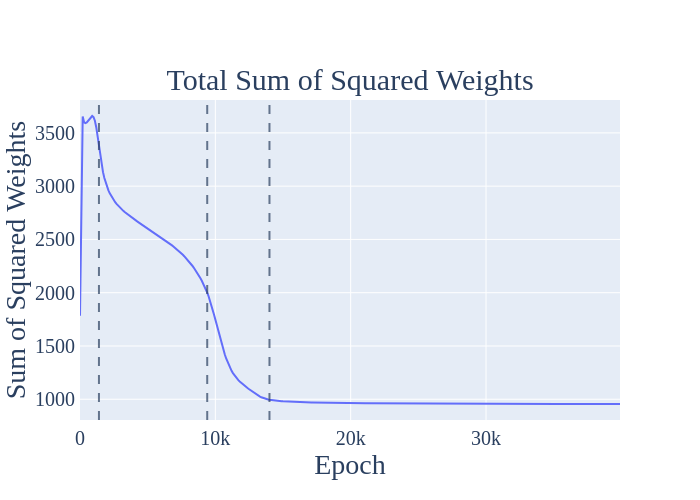

⬅️ 返回 [../INDEX.MD](../INDEX.MD) · 所属：§5

# 图 7 · 进度指标与训练阶段

[原始 PDF 图](../images/restricted_loss_new.pdf)

[原始 PDF 图](../images/gini_coefs_new.pdf)

[原始 PDF 图](../images/sum_sq_weight_total.pdf)

**图注：** 依次展示排除损失、限制损失、傅里叶 Gini 系数和权重平方和。竖线标出记忆、电路形成、清理和最后稳定期的分界。

## 关联章节与图表

- [如何计算限制损失和排除损失](../methods/3-fourier-progress-measures.md)
- [记忆、电路形成与清理](../results/6-training-phases.md)
- [进度指标的定义和读法](../tables/table-4-progress-measures.md)
- [记忆、电路形成与清理的观测对照](../tables/table-5-training-phases.md)
