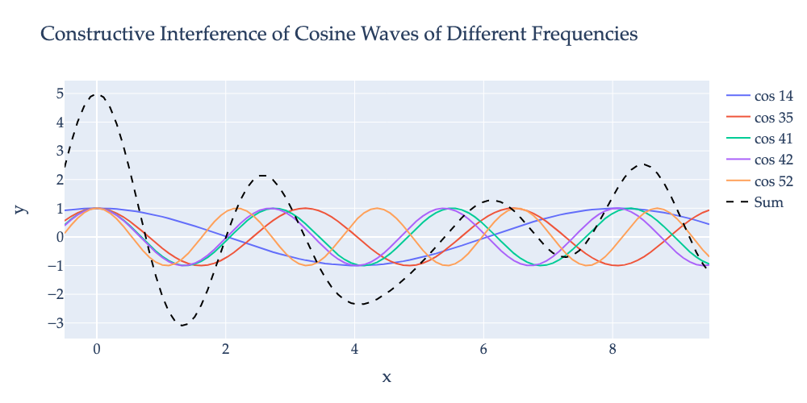

⬅️ 返回 [../INDEX.MD](../INDEX.MD) · 所属：附录 B

# 图 8 · 叠加余弦以增强正确答案的峰值

**图注：** 多个关键频率在 $x\equiv 0\pmod{113}$ 同相叠加，而其他位置的峰值错开。

## 关联章节与图表

- [用旋转计算模加法](../methods/2-fourier-multiplication.md)
- [多个频率如何拉开答案分差？](../methods/5-constructive-interference.md)
