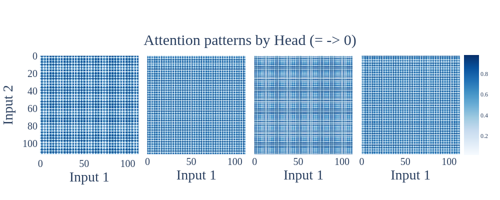

⬅️ 返回 [../INDEX.MD](../INDEX.MD) · 所属：附录 C.1

# 图 9 · 四个注意力头的周期性模式

**图注：** 以输入 $a,b$ 为坐标，展示各头从位置 `=` 到位置 $a$ 的注意力权重。

## 关联章节与图表

- [四个注意力头的角色](../results/9-attention-heads.md)
- [表 2 · 注意力头的正弦与余弦拟合](../tables/table-2-attention-head-fits.md)
