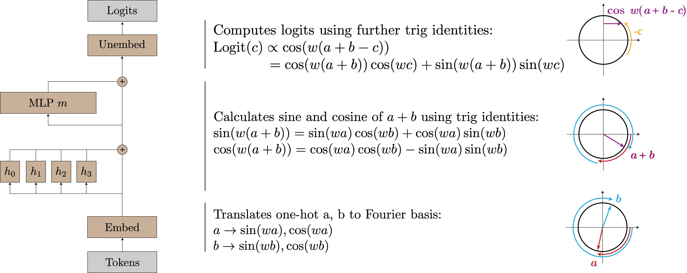
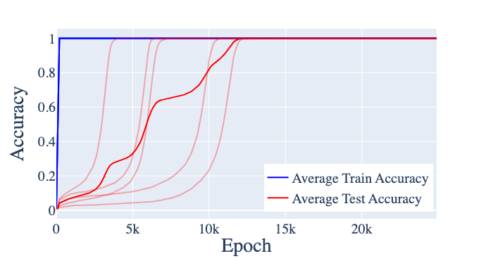
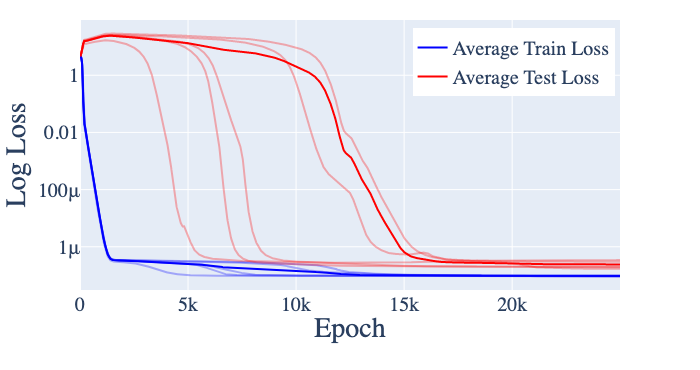
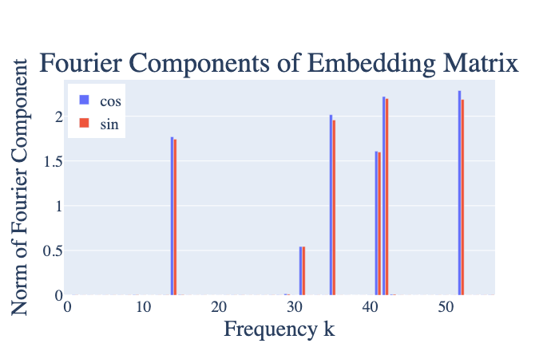
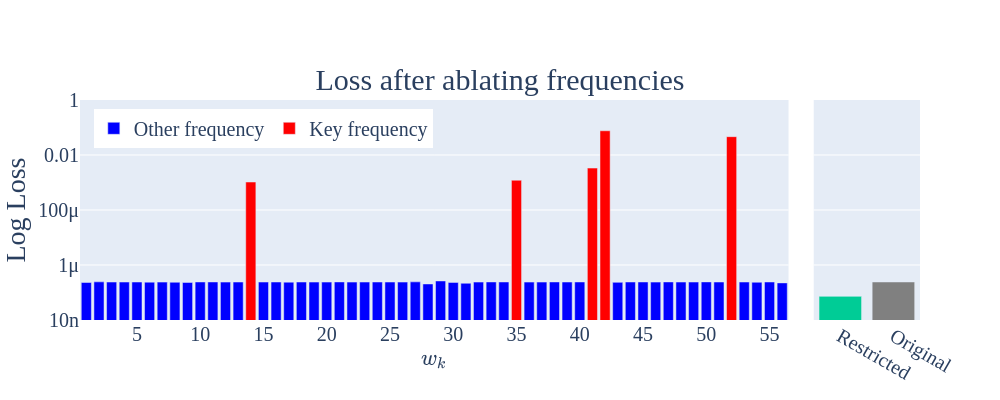
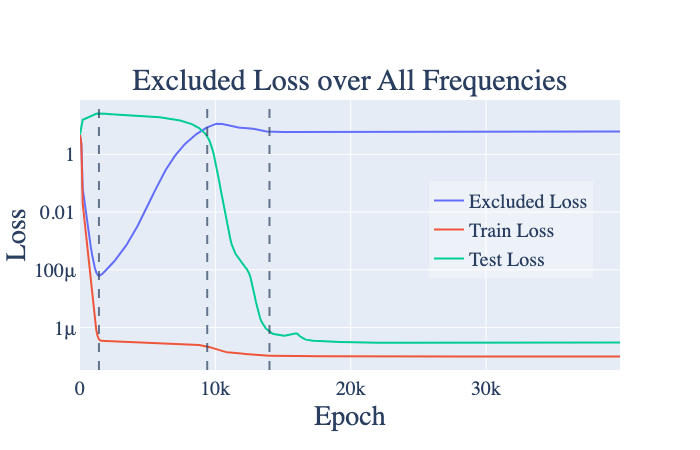
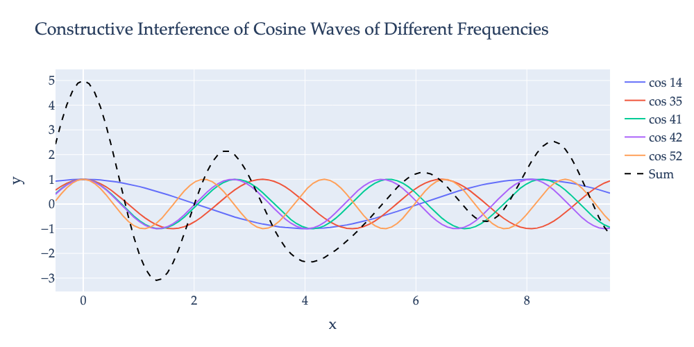
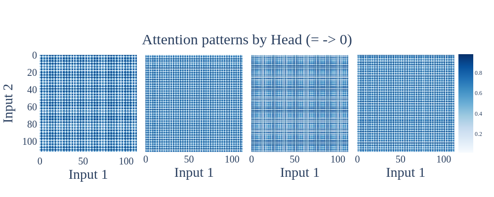

# 02 · 用机制可解释性追踪 Grokking

[返回总览](../INDEX.MD) · [技术附录](#appendix) · [上一篇：发现延迟泛化](../01/INDEX.MD)

**原论文：** *Progress measures for grokking via mechanistic interpretability* — Neel Nanda、Lawrence Chan、Tom Lieberum、Jess Smith、Jacob Steinhardt（2023）。

## 一分钟读懂

模加法模型的测试准确率突然跃升，并不表示模型在那一刻才学会算法。作者逆向分析一个模 113 加法的单层 Transformer，发现它用三角恒等式把加法转成**圆周上的旋转组合**。在训练途中只保留这套机制对应的频率，模型会比未经干预的版本更早在测试集表现出泛化。

**两种观察方式：** 只留关键频率，问「泛化电路本身学得怎样？」；去掉关键频率，问「没有这套电路，模型还能拟合训练集吗？」。结合两条曲线可以区分**记忆 → 电路形成 → 清理**。

## 展开正文

§1–3 · 研究问题、实验设置和原始曲线

准确率可以从低位突然升高，也可以长时间停在同一水平。作者希望找到能在这种跃升之前变化、且与跃升有机制联系的**进度指标（progress measures）**。与预先猜测最优算法不同，本研究先逆向分析模型真正使用的计算，再从中构造指标。相关工作包括 Barak 等人的奇偶校验进度指标、Transformer Circuits 框架，以及对 grokking 相图和 slingshot 的研究。

| 项目 | 主实验 |
| --- | --- |
| 任务 | 输入 `a b =`，在等号位置预测 $(a+b)\bmod 113$；每个整数是一个独立 token |
| 数据 | 从全部 $113^2$ 个有序输入对中抽取 30% 训练，其余全部用于测试 |
| 模型 | 单层 Transformer，宽 128，4 个 32 维注意力头，MLP 有 512 个 ReLU 隐藏单元；可学习位置嵌入，无 LayerNorm，输入嵌入和输出解嵌入不共享权重 |
| 优化 | 全批量 AdamW，学习率 $0.001$，权重衰减系数 $1$，训练 40,000 个 epoch |

模型很快拟合训练数据，约在 10,000 个 epoch 时测试准确率才接近 100%。约 10,000 是主设置的量级，不是所有种子或其他架构共有的阈值。

§3.1 · 傅里叶乘法：如何用旋转做模加法？

设 $P$ 为质数，$w_k=2\pi k/P$。对每个使用的频率 $k$，嵌入把输入 $x$ 表示为 $(\cos(w_kx),\sin(w_kx))$。复数写法是 $e^{iw_kx}$；组合 $a$、$b$ 的旋转相当于乘这两个复数，这就是「傅里叶乘法」中的乘法。注意力和 MLP 近似实现三角恒等式：

$$
\begin{aligned}
\cos(w_k(a+b)) &= \cos(w_ka)\cos(w_kb)-\sin(w_ka)\sin(w_kb),\\
\sin(w_k(a+b)) &= \sin(w_ka)\cos(w_kb)+\cos(w_ka)\sin(w_kb).
\end{aligned}
$$

输出层对每个候选答案 $c$，用线性组合算 $\cos(w_k(a+b-c))$：

$$
\cos(w_k(a+b-c))=\cos(w_k(a+b))\cos(w_kc)+\sin(w_k(a+b))\sin(w_kc).
$$

最后将多个频率的结果加权求和。正确答案 $c\equiv a+b\pmod P$ 使各项同时达到余弦峰值；其他候选的峰值通常错开。多个频率一起用，能拉开正确答案与最接近干扰项的分数。[附录有具体数值示例](#appendix)。

§4 · 四条证据：模型真的这样算吗？

1. **周期性。** 对嵌入矩阵 $W_E$ 沿 token 轴做离散傅里叶变换，显著信号集中在少数频率。主实验后续计算实际使用 $k\in\{14,35,41,42,52\}$；注意力权重、神经元激活和 logits 也表现出周期结构。
2. **权重读出的量符合恒等式。** 忽略 MLP 旁路后，$W_L=W_UW_{out}$ 把 MLP 激活映射到输出 logits。$W_L$ 能用五对正弦和余弦方向逼近，残差的 Frobenius 范数不到原矩阵的 0.55%。在这十个方向上读出的 MLP 信号，与对应的 $\cos(w_k(a+b))$ 或 $\sin(w_k(a+b))$ 相符；方差解释比例为 93.2%–98.2%。再用五个 $\cos(w_k(a+b-c))$ 项拟合全部 logits，可解释约 95% 的方差。
3. **单元与频率对得上。** 512 个 MLP 神经元中有 433 个，用单一频率的正弦、余弦二次多项式就能解释超过 85% 的激活方差。按最佳频率把这些神经元分组后，每组对输出的贡献也集中在对应频率。主实验的四个注意力头里，两个近似做单频二次计算，另外两个主要放大关键频率信号。
4. **干预保留或破坏预期功能。** 把 433 个神经元换成拟合多项式，测试准确率不变，损失仅从 $2.41\times10^{-7}$ 增至 $2.48\times10^{-7}$。单独去掉任一关键频率都会显著抬高损失；保留关键频率、删去其他频率，反而将损失降至 $7.24\times10^{-8}$。在 MLP 激活中移除 $W_L$ 的十个关键读出方向后，损失升至 5.27，高于均匀预测。

进一步核对原图：[神经元方差解释比例](images/neuron_frac_explained.png) · [频率 14 的神经元到 logits 的映射](images/w_logit_fourier_basis_freq14.png)。

§5 · 如何从频率消融区分三个训练阶段？

在每个检查点，把每个候选 $c$ 的 logits 看成定义在 $(a,b)$ 网格上的函数，沿两个输入轴做二维 DFT。修改频域分量，再逆变换回 logits 并计算交叉熵。

| 指标 | 怎么做 | 怎么读 |
| --- | --- | --- |
| **Restricted loss（限制损失）** | 保留常数项和重建关键频率 $\cos(w_k(a+b))$、$\sin(w_k(a+b))$ 的 20 个输入傅里叶项，其余置零，再查看测试损失 | 越低，说明隔离出来的泛化电路越能独立解题 |
| **Excluded loss（排除损失）** | 只移除关键频率分量，保留其余；在训练集上计算 | 越高，说明切掉泛化电路后越难拟合训练数据，剩余记忆成分越不足以解释训练表现 |
| 傅里叶 Gini、权重平方和 | 衡量 $W_E$ 和 $W_L$ 的频域范数是否集中，以及整体权重大小 | 用来观察频域稀疏化和权重变化 |

| 主实验阶段 | 观测 | 机制解释 |
| --- | --- | --- |
| **记忆**，0–1.4k epoch | 训练损失和排除损失下降；测试与限制损失高 | 训练集可被拟合，但最终的关键频率还不能独立解题 |
| **电路形成**，1.4k–9.4k | 限制损失开始下降，排除损失上升，原始训练和测试损失近乎不变 | 泛化电路已逐步参与计算，原始测试曲线还没反映出来 |
| **清理**，9.4k–14k | 测试损失陡降；权重平方和降得更快，傅里叶 Gini 快速上升 | 作者将跃升解释为泛化电路继续变强、记忆信号被削弱后不再遮蔽它 |

其余进度图：[限制损失](images/restricted_loss_new.pdf) · [傅里叶 Gini](images/gini_coefs_new.pdf) · [权重平方和](images/sum_sq_weight_total.pdf)。这些指标是利用最终模型的关键频率**回看**训练进程，不等于能事先预测任意模型何时跃升。

§5.3–6 · 权重衰减的作用与结论边界

在主模加法配置中，去掉权重衰减后没有观察到 grokking，排除损失也没有明显上升；有些 dropout 设置同样能产生延迟泛化。训练数据足够多时，训练和测试可以同步改善，即使内部仍学到同类算法，也没有先过拟合再泛化的间隔。具体数据比例、其他模数与任务见[技术附录](#appendix)。

论文展示的是一条研究路线：从可验证的机制出发设计度量，观察外部曲线所遮蔽的进展。把这种方法推广到更大的模型、多电路和更真实的任务，以及事先预测跃升的时间，都仍是开放问题。

## 原文与复现

[arXiv v3](https://arxiv.org/abs/2301.05217v3) · [论文 PDF](https://arxiv.org/pdf/2301.05217v3) · [本地 TeX（含作者贡献与致谢）](../../TeX/Grokking/arXiv-2301.05217v3/iclr2023_conference.tex) · [原论文参考文献清单](references/references.md) · [BibTeX](../../TeX/Grokking/arXiv-2301.05217v3/iclr2023_conference.bib) · [作者的交互图、Colab 与检查点](https://neelnanda.io/grokking-paper)

---

# 02 附录 · 注意力推导、对照实验与开放问题

[返回论文导读](INDEX.MD) · [返回总览](../INDEX.MD)

本页沿用原论文的附录顺序：先展开内部计算，再看结论跨种子、架构、模数和任务能否复现，最后区分实证结果与假说。

附录 A · 为什么可以用 W_L 代替整个输出过程？

输入位置 $i$ 的初始残差向量为 $x_i^{(0)}=W_Et_i+p_i$，其中 $t_i$ 是 one-hot token，$p_i$ 是位置嵌入。只在最终的 `=` 位置读取结果。注意力头 $j$ 用等号位置生成查询，用各位置生成键；softmax 得到注意力权重 $A_i^j$，各位置的值通过 OV 映射 $W_O^jW_V^j$ 加到等号位置的残差流。按附录的简写，令 $m$ 为 MLP 的 ReLU 激活，有

$$
\begin{aligned}
x^{(1)} &= x_2^{(0)}+\sum_j W_O^j W_V^j\sum_i A_i^j x_i^{(0)},\\
m &= \operatorname{ReLU}(W_{in}x^{(1)}),\\
\operatorname{Logits} &= W_U\bigl(x^{(1)}+W_{out}m\bigr).
\end{aligned}
$$

- 各头给 `=` 自身的平均注意力仅 0.1%–0.4%，消融不影响表现。忽略它以后，对两个位置做 softmax，相当于对两者分数之差取 sigmoid。
- 将 MLP 旁路置零或替换为均值，不改变主模型准确率；损失分别变为 $9.12\times10^{-7}$ 和 $7.25\times10^{-7}$。因此研究主要计算路径时可令 $\operatorname{Logits}\approx W_Lm$，其中 $W_L=W_UW_{out}$。这不意味着注意力或注意力旁路也可忽略：分别置零会将损失推高到 24.3 和 19.1。

附录 B · 单个频率可以得到正确答案，为什么还要多个？

设 $x=a+b-c$。在模 113 的整数上，任何非零频率 $k$ 对应的 $f_k(x)=\cos(2\pi kx/113)$ 都只在 $x\equiv0\pmod{113}$ 达到 1，但其他候选也可能非常接近 1。举例：$f_{14}(8)\approx0.998$，而 $f_{35}(8)\approx-0.990$。两者相加时，$x=0$ 处相长，$x=8$ 附近的假峰值则被压低。五个频率一起用，可以让正确答案的分数留出更大的余量。

附录 C.1 · 四个注意力头具体在做什么？

等号位置的查询固定，位置 $a$ 与 $b$ 的分数可写成对 token 的查表值加位置常数。忽略微小的自注意力后，权重是两分数之差的 sigmoid。实测中，查表函数接近单频正弦波，而 sigmoid 可较好地用线性函数近似。于是第 $j$ 个头从 `=` 到 $a$ 的注意力权重可拟合为

$$
A_0^j\approx 0.5+\alpha^j[\cos(w_ka)-\cos(w_kb)]+\beta^j[\sin(w_ka)-\sin(w_kb)].
$$

| 头 $j$ | $k$ | $\alpha^j$ | $\beta^j$ | 方差解释比例 |
| --- | ---: | ---: | ---: | ---: |
| 0 | 35 | −0.26 | −0.14 | 99.03% |
| 1 | 42 | 0.27 | −0.04 | 98.49% |
| 2 | 52 | 0.29 | −0.05 | 99.07% |
| 3 | 42 | −0.26 | 0.04 | 97.91% |

头 0、2 的 OV 输出也分别集中在同一频率，因此权重乘以 OV 输出可以产生单频二次项。头 1、3 的注意力模式近乎互补，OV 输出相近且包含全部五个关键频率；两者相加主要增强残差流中这些频率的一次项。用最佳线性拟合替换 sigmoid 后，测试损失从 $2.41\times10^{-7}$ 略降至 $2.12\times10^{-7}$。

补充图：[其他 MLP 单元的激活](images/neuron_acts_more_samples.png) · [只保留关键频率的准确率](images/restricted_accuracy.png) · [余弦项系数随训练变化](images/cos_coeffs_logits.png) · [逐个排除关键频率后的损失](images/excluded_loss_2D_key.pdf)。

附录 C.2 · 改种子、训练数据、深度和模数，结果如何？

| 改动 | 观察结果 |
| --- | --- |
| 同一架构、换随机种子 | 其他四个种子同样出现频域稀疏和性能跃升；关键频率的编号和数量可变 |
| 单层、$P=113$、改变训练数据占比 | 30%–50% 观察到延迟泛化，较少数据对应更长延迟；10% 或 20% 在 40k epoch 内未 grok；至少 60% 时不再出现明显的训练—测试分离 |
| 两层 | 也能看到 grokking，但部分曲线伴随 slingshot；排除损失仍可在跃升前发生变化 |
| $P=53$ 或 $P=109$ | $P=53$ 时衰减系数为 1 的设置未泛化，提高到 5 后可观察到 grokking；$P=109$ 所见行为与主实验相似 |
| $P=401$ | 30% 数据在测试过的不同衰减系数下均直接泛化；衰减系数为 1 时，20% 也直接泛化，5% 和 10% 则在实验内保持过拟合 |

采用权重衰减且能良好泛化的受分析模型使用傅里叶乘法的某个变体，但没有固定的频率集合。Dropout 模型的嵌入和读出在傅里叶基底上不那么稀疏，尤其是 $p=0.2$ 时对 logits 的余弦拟合较弱。最后一层 MLP 的旁路消融总体保留较高准确率，但部分两层模型有小幅下降。

对照图：[训练步数与数据比例](images/appendix-only/steps_to_convergence.pdf) · [两层模型的排除损失](images/2l_excluded_loss_full.png) · [模 53](images/weight_decay_5_small_prime_modulus.png) · [模 401](images/second_large_prime_loss_graph.png)。

附录 D · 正则化、slingshot 与其他算法任务

**正则化对照。** 主配置去掉权重衰减后没有 grokking，排除损失也没有上升。把权重衰减替换为 MLP dropout，$p=0.2$、$p=0.5$ 的三次运行均观察到 grokking；测试的 $\ell_1$ 惩罚未重现此结果。这是对特定设置的对照，并不要求所有 grokking 都有显式权重衰减。原文附录 D.1 对不同衰减系数列出的时间顺序与该段结论及图注相反，因此这里不采用那组时间作定量比较；可直接对照 [0.3 的曲线](images/appendix-only/1l-grokking-weight-decay-03.pdf)和 [3.0 的曲线](images/appendix-only/1l-grokking-weight-decay-3.pdf)。

**Slingshot 对照。** 两层模型常出现这种优化波动，降低损失计算精度可在单层模型里诱发类似现象，但许多带权重衰减的单层模型没有 slingshot 也会 grok。作者把自适应优化器与不同尺度梯度的相互作用视为可能原因，不把 slingshot 当作必要步骤。

**有限数据对照。** 每步抽取新数据时，以下三项任务没有出现长时间训练—测试分离；改为固定的小训练集后，均可观察到延迟泛化。

| 任务 | 固定样本数 / 模型 | 每步抽新数据 vs. 固定数据 |
| --- | --- | --- |
| 五位数加法 | 700 / 单层完整 Transformer | [逐输出 token 损失](images/5_digit_add_infinite_per_token.png) · [固定训练集](images/5_digit_add_finite_linear.png) |
| 重复子序列预测 | 512 / 两层仅注意力 | [每步抽样](images/induction_head_infinite_linear.png) · [固定训练集](images/induction_head_finite_linear.png) |
| Skip trigram：输出序列中唯一不小于 10 的 token | 512 / 单层仅注意力 | [每步抽样](images/skip_trigram_infinite_linear.png) · [固定训练集](images/skip_trigram_finite_linear.png) |

五位数加法的逐 token 曲线还有一个细节：即使没有 grokking，不同输出位也可以在不同时间突然改善，总损失可能盖住部分跃升。**相变与延迟泛化不是同义词。**

附录 E–F · 作者提出哪些假说？哪些问题还没解决？

- **记忆容易达到，泛化可能更省参数范数。** 有限数据使记忆足以较早降低训练误差。作者提出，在相同训练损失下，随着样本量增加，记忆更多样本的复杂度通常增加，而实现同一算法的复杂度不一定增加；正则化因而可能让训练转向泛化解。训练准确率 100% 不等于交叉熵为零，模型仍可继续通过改变 logits 降低损失。
- **电路的组成可能制造相变。** 在重复子序列任务中，单独的前一 token 注意力头或归纳头不能完成任务，两者组合才能发挥作用。作者讨论了彩票假说、随机游走、局部有用组件逐步叠加等解释。模块相互增强、使形成后期的优化加快，是一个待验证的机制假说；主模加法实验的早期进度不支持「全程无进展，最后随机撞到解」作为唯一解释。
- **度量能否用于更大模型？** 原文提出三条路径：有完整电路解释时直接度量组成部分；只有局部解释时用小模型启发局部度量；如果解释仍不透明，则探索自动化过程的输出或任务无关的度量。它们都没有在本文中解决如何预测大型模型的涌现时间。

[完整附录和原始表格（PDF）](https://arxiv.org/pdf/2301.05217v3) · [本地 TeX](../../TeX/Grokking/arXiv-2301.05217v3/iclr2023_conference.tex) · [作者复现页面](https://neelnanda.io/grokking-paper)
