← [论文索引](../INDEX.MD)

# Appendix · Where induction heads form

In this section we examine: Where are induction heads located in models? Do they generally form in the second layer, or the last layer, or somewhere else?

## Small attention-only models

In our attention-only models, induction heads form in the last layer.

(In these plots, each point represents a head, colored by layer and arranged along the x-axis by depth in the model. Th height of the point is the prefix matching score of that head.)

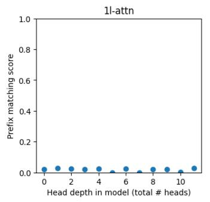

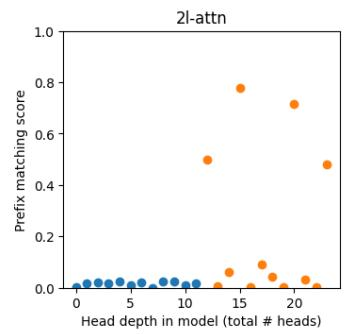

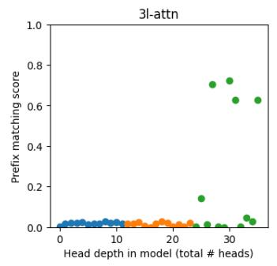

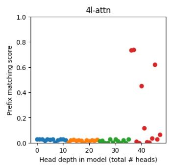  
Small models with MLPs:

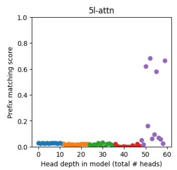

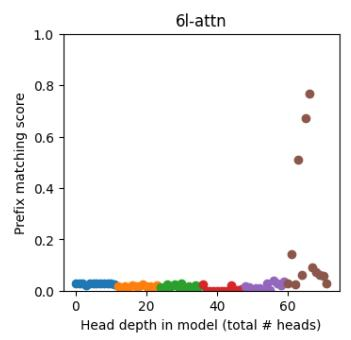

In small models with MLPs, by the 5L and 6L size, the induction heads form more in the second-to-last layer  
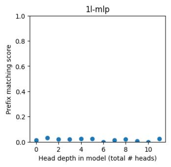

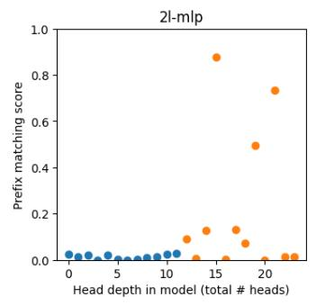

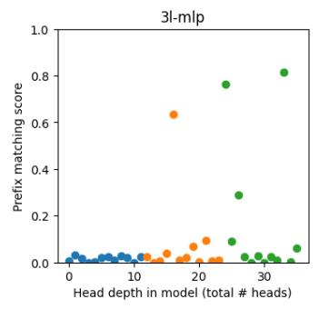

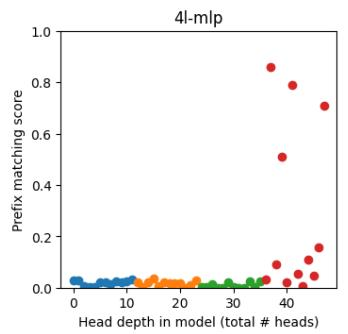

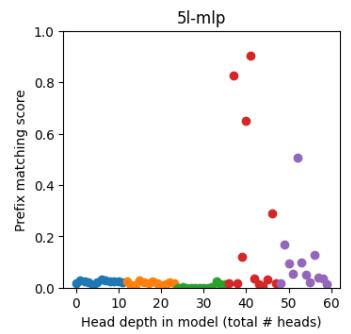

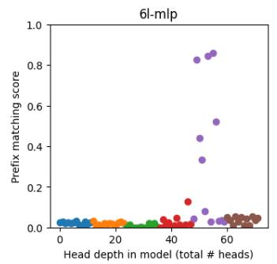

## Full-scale models:

In the models in our full-scale sweep, induction heads form earlier. In fact, in 24L and 40L models the majority of induction heads form before the halfway point in model depth.

Note that in these plots, only a randomized sample of 100 heads (with selection biased towards those scoring highly on prefix matching) are shown as opaque dots; most of the datapoints are left translucent for ease of reading.

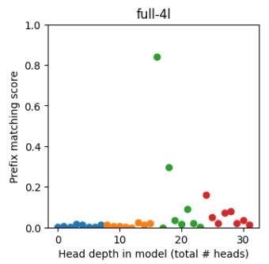

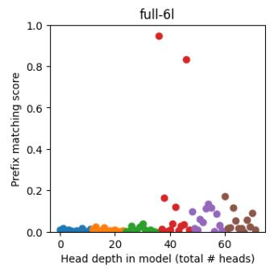

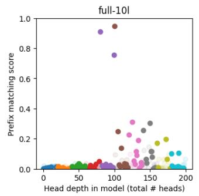

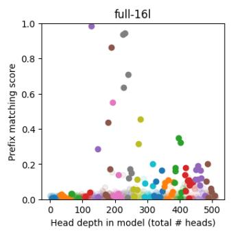

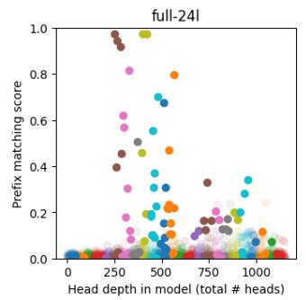

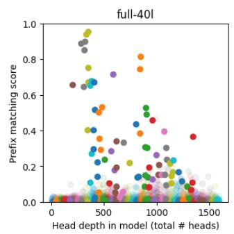

