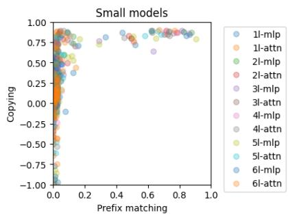
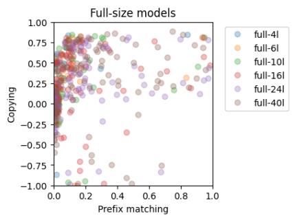
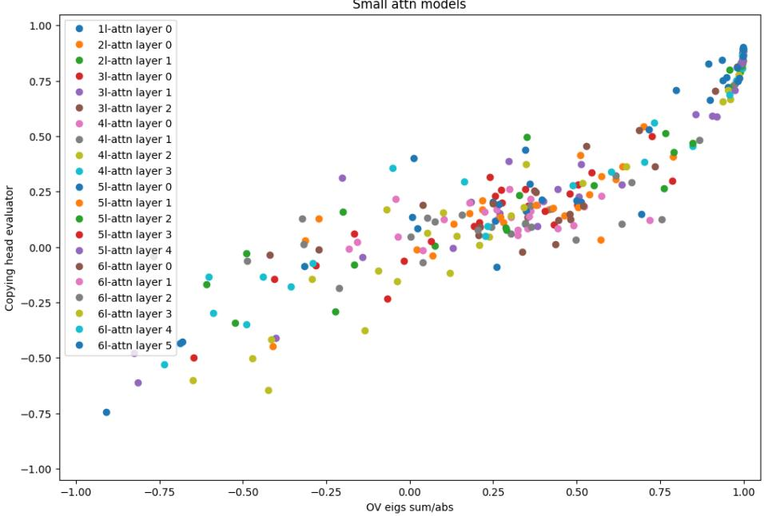
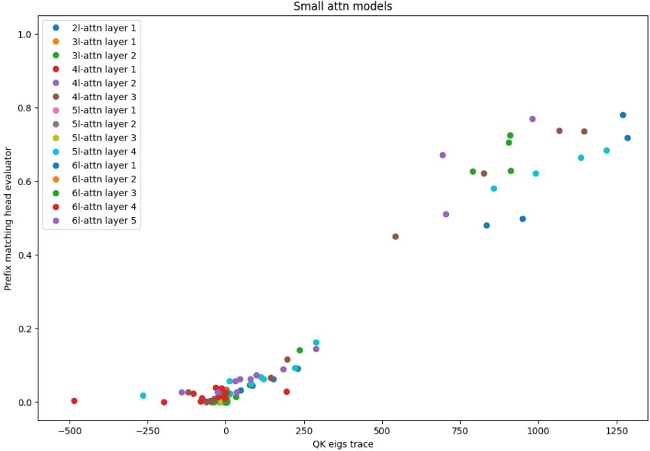

← [论文索引](../INDEX.MD)

# Appendix · Score Distributions and Evaluator Validation

## Distribution of scores

What is the distribution of heads’ scores on our head activation evaluators?

The distribution is sharper in our small models than our full-size models. In both cases, heads with a positive prefix matching score are more likely to have a positive copying score, and this correlation is even stronger for the highes prefix matching scores.

(For models with more than 100 heads, a subset of heads is plotted, as seen in the opaque versus translucent datapoints immediately above.)

## Validating head activation evaluators

We show here that our head activation evaluators (that we use to measure the properties in our definition of induction heads) correlate well with mathematically-based measures in small attention-only models.

## Copying

Our copying evaluator correlates well with the OV matrix of each head. Specifically here we plot against the sum of the eigenvalues, divided by the absolute value of the eigenvalues, which is a measure of what fraction of the eigenvalues are positive vs. negative.

  
Prefix matching

Our prefix matching evaluator correlates well with the trace of QK eigenvalues for the previous-token QK-circuit term.  

