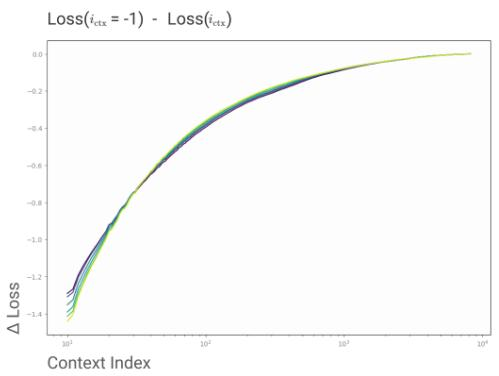
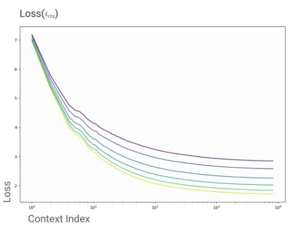
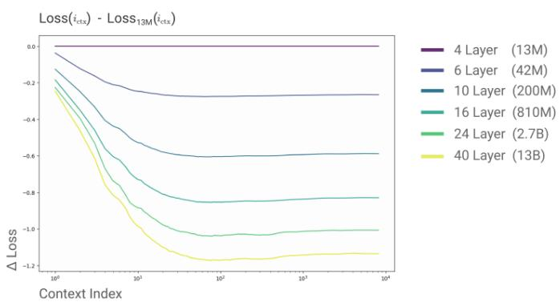
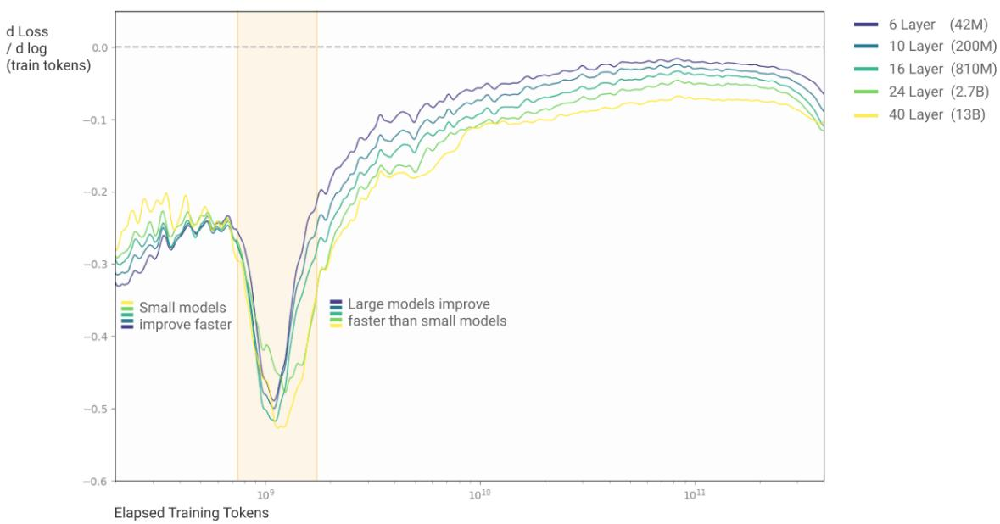

← [论文索引](../INDEX.MD)

# Unexplained Curiosities

As with all scientific investigations, in the course of this work we’ve encountered a few unexplained phenomena. In this section, we discuss these and provide very preliminary investigations of a few that were especially surprising.

## Seemingly Constant In-Context Learning Score

One of the stranger observations in this paper is that in-context learning score (as we've defined it: the loss of the 500th token in the context minus the loss of the 50th token in the context) is more or less the same for all models after the phase change. It appears to not matter whether the model is a tiny two layer model or a fairly large 13 billion parameter model, nor whether the model has just gone through the phase change or trained much longer. The only thing that matters, seemingly, is whether the model has gone through the phase change at all.

A natural question is whether this might be an artifact of the relatively arbitrary definition. Afterall, there's no reason to privilege token index 50 or 500 in the context. But it appears that varying these doesn't matter. In the following plot, we show how the large models' "in-context learning score" varies if we define it instead as the difference between the loss at the final token in the context (8192) and other indices. While there are small differences between models – for some definitions, small models would do slightly more "in-context learning"! – all definitions appear to show that27 the amount of in-context learning varies only slightly between models.

"IN-CONTEXT LEARNING SCORE" SENSITIVITY TO DEFINITION

  
Our in-context learning score requires one to pick two context indices to compare. But it appears that for a wide range of definition choices, models of different sizes still have nearly identical amounts of in-context learning. For some definitions, small models do more

How can this be? First, it's important to be clear that large models still predict tokens at all indices better than small models, and they're best at predicting later tokens. What's going on is that the large models gain all their advantage over small models very early in the context. In fact, the majority of the difference forms in the first ten tokens:

LARGE MODELS ARE BETTER AT PREDICTING ALL TOKENS, INCLUDING LATER ONES

  
LARGE MODELS GAIN THEIR LOSS ADVANTAGE EARLY IN THE CONTEXT

It seems that large models are able to pull a lot of information out of the very early context. (This might partly be, as an example, because their increased world knowledge mean they don't need to gain as much information from the context.) They then further decrease their loss by a roughly fixed amount over the remainder of the context. It seems likely this fixed amount is in some sense28 "more difficult in-context learning" for large models, since they're starting from a lower loss baseline. While it still seems mysterious to us why models should have the same in-context learning score, this perspective makes it "strange" rather than "shocking".

## Phase Change Effect on Loss Derivatives

Another observation we find quite striking is that if one looks at the derivative of the loss curves of models of different sizes, it appears that their order switches at the phase change. This is most easily seen by plotting the derivative of loss with respect to the log of elapsed tokens (since loss curves are often most easily reasoned about on a log x-axis). The key observation is that the loss decreases more slowly for small models than large models before the phase change, but the opposite is true after.

LOSS DERIVATIVE ORDER APPEARS TO INVERT AT PHASE CHANGE  

While it doesn't seem that surprising that small models learn more quickly in early training, it is striking that this inversion seems to coincide with the phase change. It's another piece of evidence that suggests the phase change is an important transition point in the training of transformers.

## Additional Curiosities

## In the model analysis table:

The 6-layer attention-only model has an unusual head that develops in the later half of training. This head is not an induction head, and yet ablating it has an effect similar to reversing the phase change (in the “before-and-after vector” attribution plot). What is this head?

The 4-layer MLP model ablations are nowhere near as “peaky” as those of any other model. What is different about this model’s development?

The 6-layer MLP model shows a “loss spike”. We don’t yet know what causes loss spikes.

The 6-layer MLP model has one lone induction head whose ablation has the opposite effect on the in-context learning score. What is this head?

## And in the Appendix:

Full-scale models above 16 layers start to show a small number of heads that score well on “prefix search”, but get a negative score on copying, which means they are not induction heads. What can we learn about these “anti-copying prefix-search” heads?

