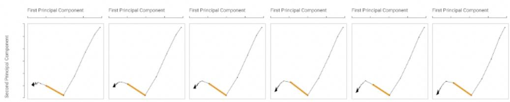
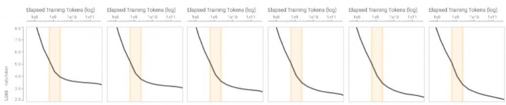
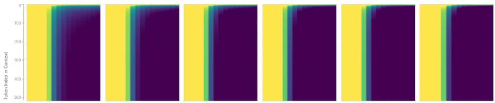
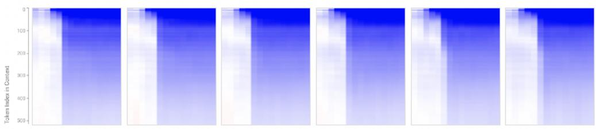
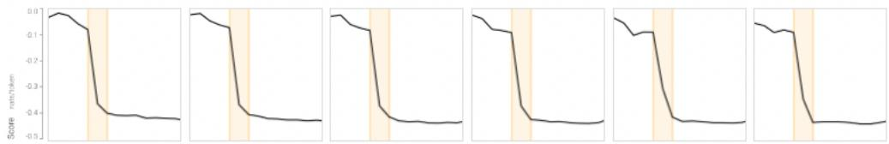
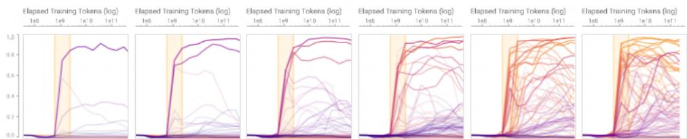

← [论文索引](../INDEX.MD) · [模型分析指标](7-model-analysis.md) · [大规模模型规格表](../tables/table-10-model-properties.md)

# Model Analysis Table · Full-scale models

This experiment series analyzes a sweep of typical transformers, spaced exponentially in size, up to a 13 billion parameter model. The goal is to show that the phenomena we observed in small models can be seen in larger models as well. For these models, we unfortunately have lower time resolution (note that the x-axis of most plots has changed to a log scale). We are also unable to provide complete ablations. The main observation to make is that results are roughly the same as seen in the small models. More...

## PCA OF TOKEN LOSSES

## MODELS OVER TRAINING

## LOSS OVER TRAINING

Loss curve showing Loss(ntrain) after the model is trained on ntrain tokens of training data.

The orange banddenotes phase change

  
4-LAYER 6-LAYER 10-LAYER 16-LAYER 24-LAYER 40-LAYER TRANSFORMER TRANSFORMER TRANSFORMER TRANSFORMER TRANSFORMER TRANSFORMER (13M PARAMS) (42M PARAMS) (200M (810M (2.7B PARAMS) (13B PARAMS) PARAMS) PARAMS)

## LOSS OVER TRAINING, BROKEN DOWN BY CONTEXT INDEX

Heatmap of Loss(ntrain, ictx), the average loss of ictx token in context after ntrain elapsed

## DERIVATIVE OF LOSS WRT CONTEXT INDEX

Heatmap of dLoss(ntrain, ictx) / d ln(ictx). The log vertical partial derivative of the above graph.

## "IN-CONTEXT LEARNING SCORE"

How much better the model is at predicting the 500th token than the 50th? We use this as a proxy for how good the model is at in-context

## ATTENTION HEADS OVER TRAINING

## "PREFIX MATCHING SCORE"

Each line is an attention head. Y axis is the average fraction of a head's attention weight given to the token we expect an induction head to attend to -- the token where the prefix matches the present context -- on random synthetic data. Heads are colored by layer depth: early;late. More...

LOSS OVER TRAINING Loss curve showing Loss(ntrain) after the model is trained on $n _ { \mathrm { t r a i n } }$ tokens of training data. interval.

