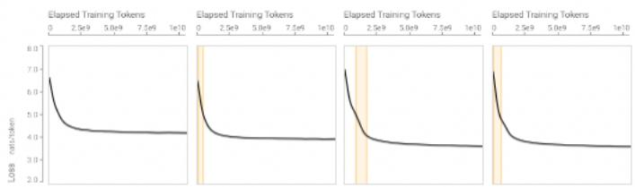
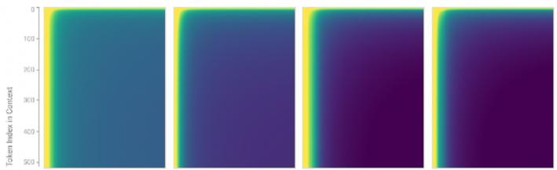
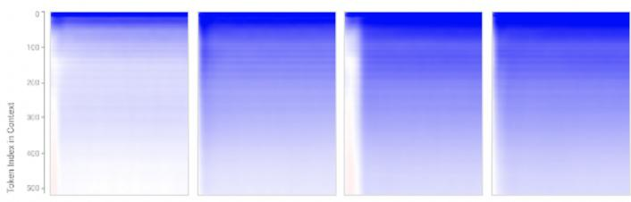
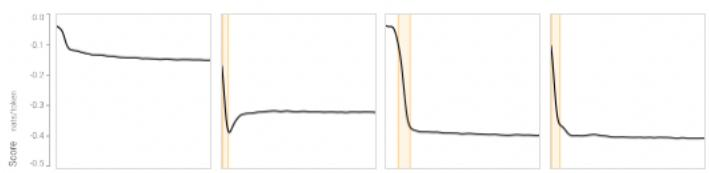
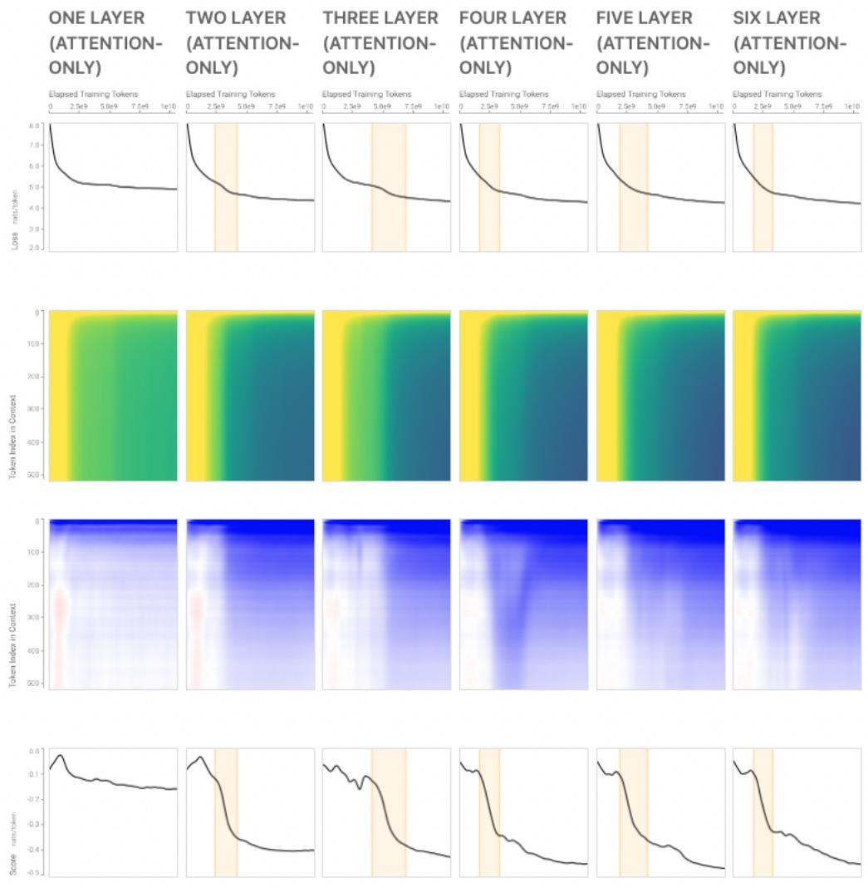
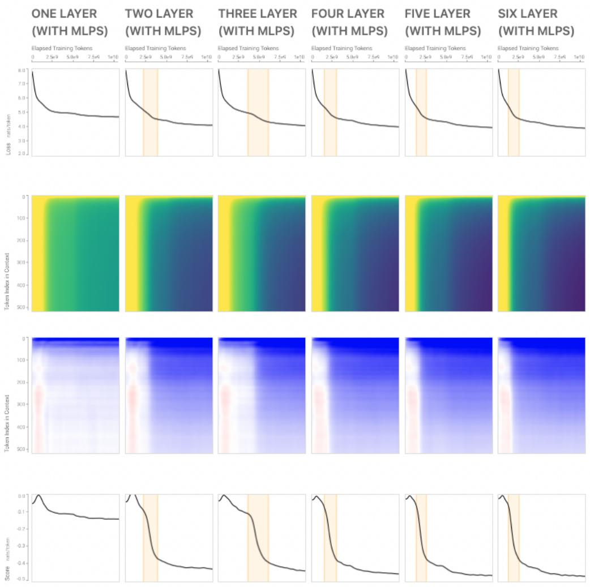

← [论文索引](../INDEX.MD) · [模型分析指标](7-model-analysis.md)

# Model Analysis Table · Smeared-key and dataset controls

## "SMEARED KEY" ARCHITECTURE MODIFICATION + CONTROLS

This experiment series analyzes "smeared key" models, which are designed so that a single attention layer can implement induction heads (see Argument 2). For each smeared key model, a regular control model is provided (trained exactly the same) for comparison. The key observations are that (1) a one-layer smeared-key model experiences the phase change, while a regular onelayer model does not; and (2) the two-layer smeared-key model experiences a phase change earlier than a baseline model. More..

ONE LAYER (VANILLA)

ONE LAYER (SMEARED KEYS)

TWO LAYER (VANILLA)

TWO LAYER (SMEARED KEYS)

## LOSS OVER TRAINING, BROKEN DOWN BY CONTEXT INDEX

Heatmap of Loss(ntrain, ictx), the average loss $i _ { \mathrm { c t x } }$ token in context after ntrain elapsed

## DERIVATIVE OF LOSS WRT CONTEXT INDEX

Heatmap of dLoss(ntrain, ictx) / d ln(ictx). The log vertical partial derivative of the above graph.

## "IN-CONTEXT LEARNING SCORE"

How much better the model is at predicting the 500th token than the 50th? We use this as a proxy for how good the model is at in-context

## SMALL ATTENTION-ONLY TRANSFORMERS (DIFFERENT DATASET)

This experiment series studies transformers of the same architecture as the small attention-only transformers, on a different dataset consisting only of internet books. More..

ONE LAYER(ATTENTION-ONLY)

## SMALL TRANSFORMERS (WITH MLPS) (DIFFERENT DATASET)

This experiment series studies small normal transformers (with MLP layers), on a different dataset consisting only of internet books

  
How much better the model is at predicting the 500th token than the 50th? We use this as a proxy for how good the model is at in-context

