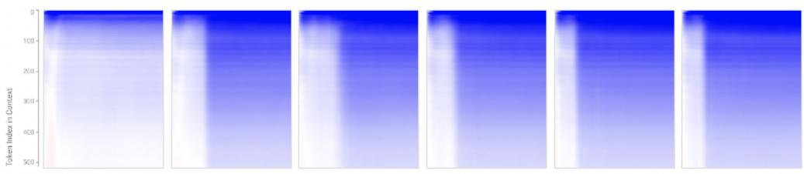

← [论文索引](../INDEX.MD)

# Model Analysis Table · How to read the plots

The arguments above are based on analysis of 34 decoder-only Transformer language models, with different snapshots saved over the course of training, for one run of training per model. The models are drawn from four different model series as follows:

“Small, attention-only models”, a series of models (from 1-layer to 6-layer) that do not have MLPs, and were trained specifically for the present investigations.

“Small models with MLPs”, a series of models (from 1-layer to 6-layer) that have both attention and MLP layers, and were trained specifically for the present investigations.

“Full-scale models”, a series of successively-larger models with MLPs (ranging from 4 layers and 13M parameters, up to 40 layers and 13B parameters), that are used as the basis for multiple projects at Anthropic.

“Smeared key models”, a targeted architectural experiment designed to allow transformers of any depth to express induction heads.

The dataset used for training the small models and smeared key models was an earlier version of the dataset described in Askell et al. , consisting of filtered common crawl data and internet[18] [19] books, along with several other smaller distributions , including approximately 10% python code.[20] The full-scale models were trained on an improved version of roughly the same data distribution. Additionally, another set of the small models was trained on a different dataset, consisting of just internet books, to explore the impact of varying the dataset. All models trained on a given dataset saw the same examples in the same order. Models never saw the same training data twice.

For more details on model architecture and training, continue past the table below, to the Model Details section.

In the Model Analysis Table below, each row includes a brief summary of the measurement shown. For a more in-depth explanation of the data collection and results analysis, see the Appendix.

Heatmap of Loss(ntrain, ictx), the average loss of ictx token in context after ntrain elapsed

  
ONE LAYER(ATTENTION-ONLY)  
TWO LAYER (ATTENTION-ONLY)  
THREE LAYER (ATTENTION-ONLY)  
FOUR LAYER (ATTENTION-ONLY)  
FIVE LAYER (ATTENTION-ONLY)  
SIX LAYER (ATTENTION-ONLY)  
The vector of per-token losses is a way to map different neural network behavior to the same vector space. We take 10,000 individual token predictions per model, and project them onto the first two principal components. This shows how the large-scale-behavior of multiple networks evolve over training. More...

