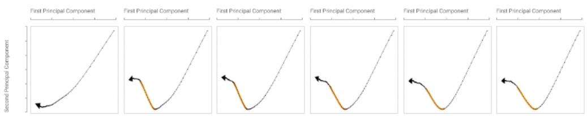
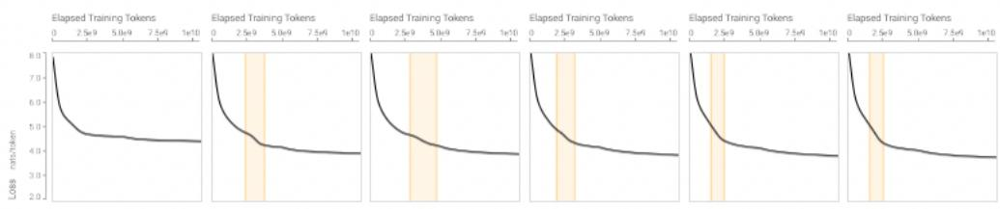
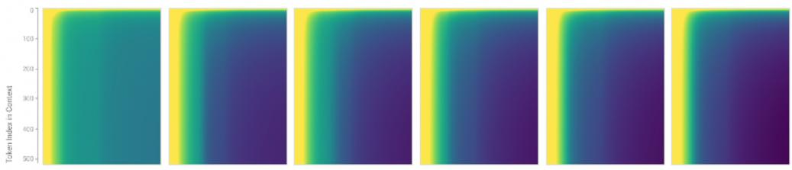
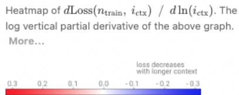
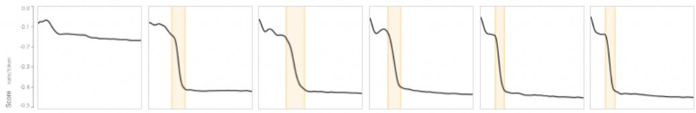
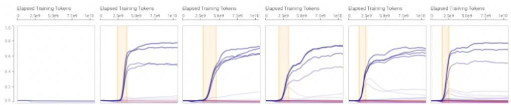
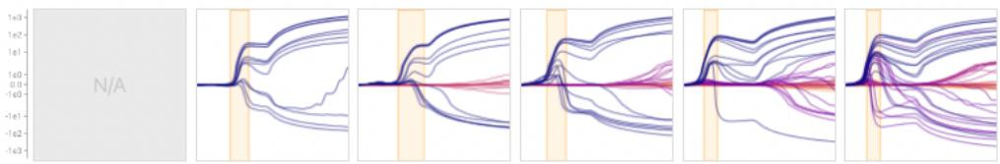
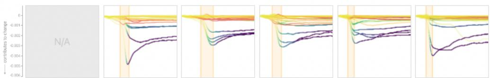
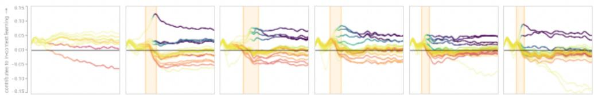

← [论文索引](../INDEX.MD) · [模型分析指标](7-model-analysis.md)

# Model Analysis Table · Small attention-only models

This experiment series studies small attention-only transformers. because these are the models we have the strongest theoretical understanding of (see the framework paper). For these small models, we're able to capture snapshots with a high time resolution over early training. These experiments are the ones that most cleanly demonstrate the phase change and link it to induction heads. Note how (1) many models undergo a discontinuous phase change (seen most clearly in the PCA plot and in-context learning score): (2) it appears to be caused by induction heads (see ablations); and (3) the only model without a phase change is the onelayer model. More...

## PCA OF TOKEN LOSSES

## MODELS OVER TRAINING

## LOSS OVER TRAINING

## LOSS OVER TRAINING, BROKEN DOWN BY CONTEXT INDEX

## DERIVATIVE OF LOSS WRT CONTEXT INDEX

## "IN-CONTEXT LEARNING SCORE"

How much better the model is at predicting the 500th token than the 50th? We use this as a proxy for how good the model is at in-context

## ATTENTION HEADS OVER TRAINING

## "PREFIX MATCHING SCORE"

Each line is an attention head. Y axis is the average fraction of a head's attention weight given to the token we expect an induction head to attend to -- the token where the prefix matches the present context -- on random synthetic data. Heads are colored by layer depth early;late. More...

## TRACE OF QK EIGENVALUES

Each line is an attention head. Y axis is the trace of the W in the attention head's Id $h _ { \mathrm { p r e v } } \otimes W$ QK circuit term, scaled by how well hprey matches an ideal previous token head. Only defined for models more than one layer deep. Heads are colored by laver depth:early:

## ABLATION TO "BEFORE-AND-AFTER" VECTOR

Each line is an attention head. Y axis is the projection of the observed per-token loss differences when ablating an attention head onto the difference in per-token losses before and after the bump. More... Heads are colored by type:

previous token;induction;other.

## ABLATION ATTRIBUTION TO "IN-CONTEXT LEARNING SCORE"

Each line is an attention head. Y axis is the change in the "in-context learning score" observed when ablating each attention head. previous token;induction;other.

Loss(ntrain, ictx = 500)

