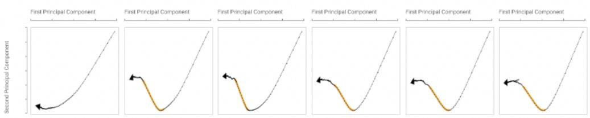
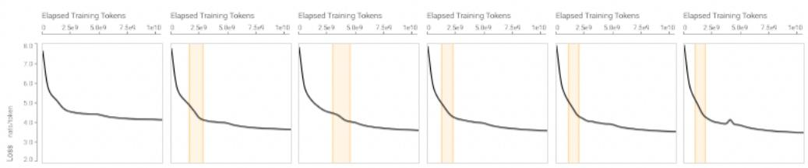
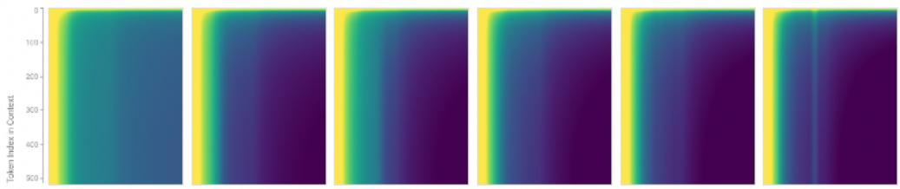
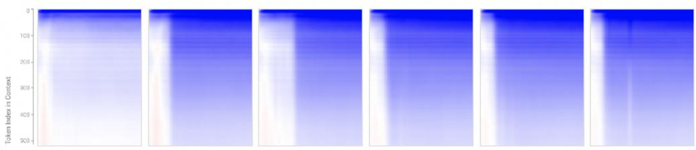
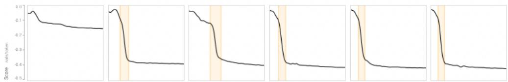
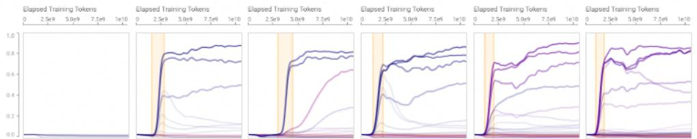
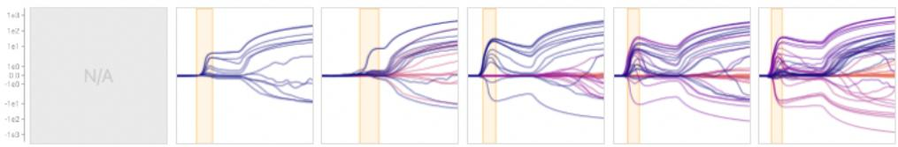
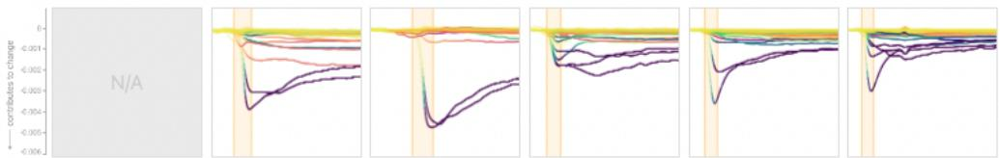
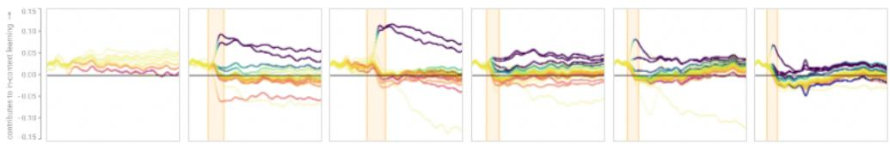

← [论文索引](../INDEX.MD) · [模型分析指标](7-model-analysis.md)

# Model Analysis Table · Small models with MLPs

This experiment series studies small normal transformers (with MLP layers, unlike the above). For these small models, we're able to capture snapshots with a high time resolution over early training. The main observation to take away is that the results are essentially the same as the attention-only models (where we have a stronger theoretical understanding. More...

ONE LAYER(WITH MLPS)

TWO LAYER (WITH MLPS)

THREE LAYER (WITH MLPS)

FOUR LAYER (WITH MLPS)

FIVE LAYER (WITH MLPS)

SIX LAYER (WITH MLPS)

## PCA OF TOKEN LOSSES

The vector of per-token losses is a way to map different neural network behavior to the same vector space. We take 10,000 individual token predictions per model, and project them onto the first two principal components. This shows how the large-scale-behavior of multiple networks

## MODELS OVER TRAINING

## LOSS OVER TRAINING

The orange banddenotes phase change interval.

## LOSS OVER TRAINING, BROKEN DOWN BY CONTEXT INDEX

Heatmap of Loss(ntrain, ictx), the average loss of ictx token in context after ntrain elapsed

## DERIVATIVE OF LOSS WRT CONTEXT INDEX

Heatmap of dLoss(ntrain, ictx) / d ln(ictx). The log vertical partial derivative of the above graph.

## "IN-CONTEXT LEARNING SCORE"

How much better the model is at predicting the 500th token than the 50th? We use this as a proxy for how good the model is at in-context

## ATTENTION HEADS OVER TRAINING

## "PREFIX MATCHING SCORE"

Each line is an attention head. Y axis is the average fraction of a head's attention weight given to the token we expect an induction head to attend to -- the token where the prefix matches the present context -- on random synthetic data. Heads are colored by layer depth: early;late. More...

## TRACE OF QK EIGENVALUES

Each line is an attention head. Y axis is the trace of the W in the attention head's Id © hprev © W matches an ideal previous token head. Only defined for models more than one layer deep. Heads are colored by layer depth:early;

## ABLATION TO "BEFORE-AND-AFTER" VECTOR

Each line is an attention head. Y axis is the projection of the observed per-token loss differences when ablating an attention head onto the difference in per-token losses before and after the bump. More... Heads are colored by type:

previous token;induction;other.

## ABLATION ATTRIBUTION TO "IN-CONTEXT LEARNING SCORE"

Each line is an attention head. Y axis is the change in the "in-context learning score" observed when ablating each attention head. More... Heads are colored by type: previous token:induction:other.

  
The vector of per-token losses is a way to map different neural network behavior to the same vector space. We take 10,000 individual token predictions per model, and project them onto the first two principal components. This shows how the large-scale-behavior of multiple networks evolve over training. More...

