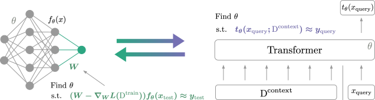

← [论文索引](../INDEX.MD) · [引言](../introduction/introduction.md)

# 图 1 · 元学习与基于注意力的上下文学习

左：在支持集上用 GD 调整输出层，再由查询误差信号训练共享参数。中：Transformer 把支持集当作上下文，并由前向传播直接预测查询。右：在构造下，$K$ 步 GD 与 $K$ 层线性注意力产生相同的预测更新。

[示意原图（PDF）](../images/figure_1.pdf) · [右侧实验面板（PDF）](../images/linear/rolling_out/train.pdf)
