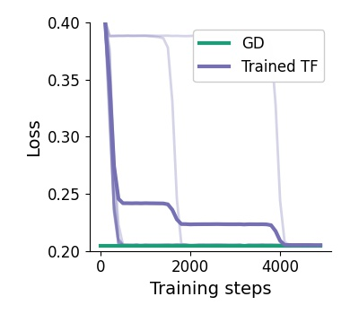
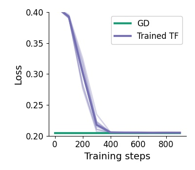
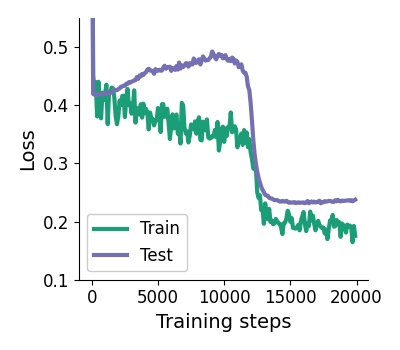

← [论文索引](../INDEX.MD) · [训练相变](../appendix/11-phase-transitions.md) · [单层结果](../results/1-single-layer.md)

# 图 15 · 训练相变与 grokking 式泛化

单头在部分种子下停滞后才收敛；双头更稳定。固定在 8,192 个任务上训练带 MLP 的单块模型时，测试损失在上升后骤降。

