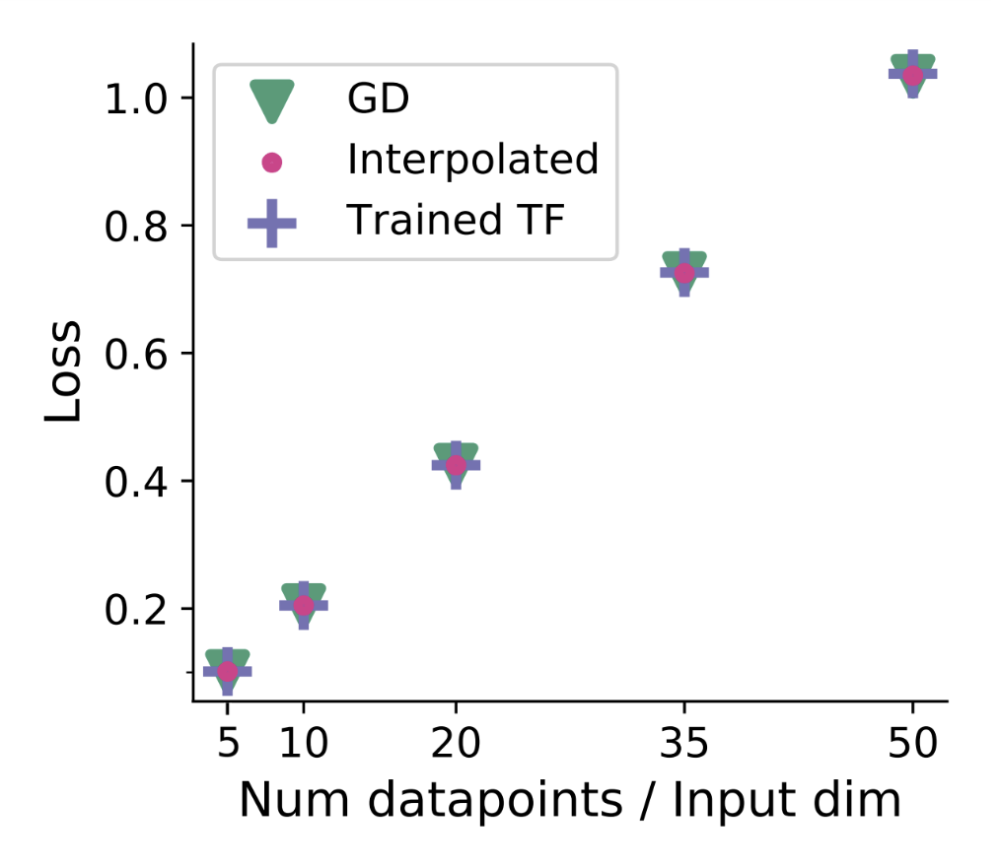

← [论文索引](../INDEX.MD) · [单层结果](../results/1-single-layer.md)

# 图 2 · 单层线性注意力与一步 GD

从左到右：训练所得单层接近 GD 损失；两者的预测和查询导数对齐；缩放后的权重可直接插值；改变输入范围时，分布外损失随 GD 一同变化。

[训练损失](../images/linear/linear_one_layer_one_head_0_002/train.pdf) · [函数对齐](../images/linear/linear_one_layer_one_head_0_002/sim.pdf) · [分布外损失](../images/linear/linear_one_layer_one_head_0_002/normal.pdf)

