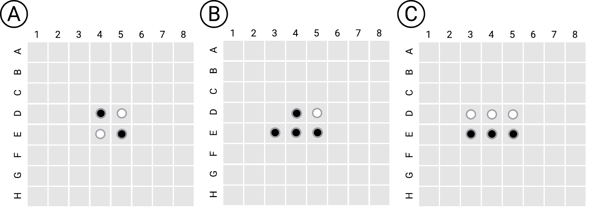

返回 [论文索引](../INDEX.MD) · 插图

# Figure 1. Othello rules

[Original figure (PDF)](../../../TeX/Othello-GPT/arXiv-2210.13382v5/figs/othello_rules.pdf)

(A) Play starts with four discs in the center, two of each color. (B) Black moves first. A move outflanks and flips at least one opponent disc. (C) The opponent repeats the process. When there are no legal moves, the game ends.

See [datasets and rules](../methods/1-datasets.md).
