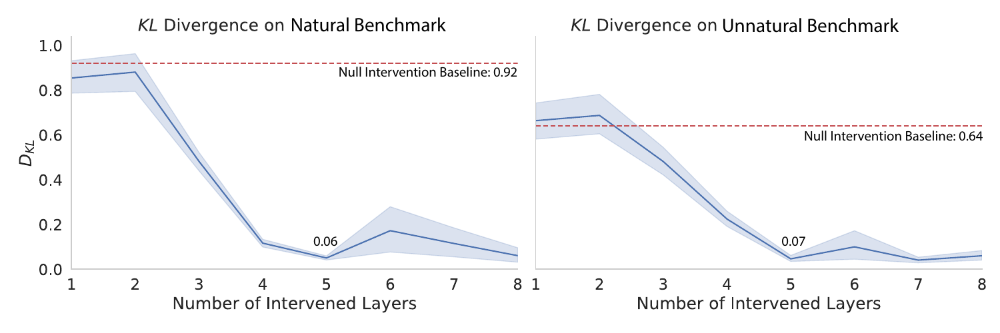

返回 [论文索引](../INDEX.MD) · 插图

# Figure 10. Intervention KL divergence

[Original figure (PDF)](../../../TeX/Othello-GPT/arXiv-2210.13382v5/figs/intvn_res_kl.pdf)

The same benchmark measured by KL divergence between predictions and a uniform distribution over legal moves.

See [Appendix F](../appendix/f-alternative-metrics.md).
