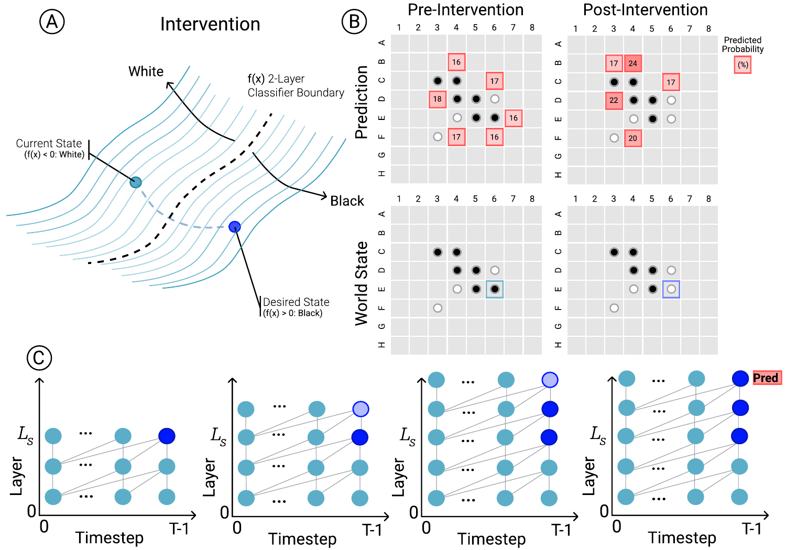

返回 [论文索引](../INDEX.MD) · 插图

# Figure 2. Counterfactual board intervention

[Original figure (PDF)](../../../TeX/Othello-GPT/arXiv-2210.13382v5/figs/intervention_explanation.pdf)

(A) Edit the probed state of E6 from white to black. (B) The bottom boards show the inferred positions; the top boards show next-move predictions before and after the intervention. (C) The edit is applied at the last token from a chosen layer onward. Light blue marks untouched activations; dark blue marks affected activations. Each replacement is followed by computation through the next layer, which can partially undo the edit.

See [intervention technique](../methods/4-intervention.md) and [results](../results/4-causal-role.md).
