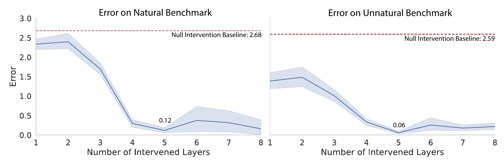

返回 [论文索引](../INDEX.MD) · 插图

# Figure 3. Intervention errors by starting layer

[Original figure (PDF)](../../../TeX/Othello-GPT/arXiv-2210.13382v5/figs/intvn_res_err.pdf)

Red dashed lines are null baselines: the pre-intervention prediction evaluated against post-intervention ground truth. Shading is a 95% confidence interval.

See [causal evaluation](../results/4-causal-role.md) and [starting-layer ablation](../appendix/g-intervention-hyperparameters.md).
