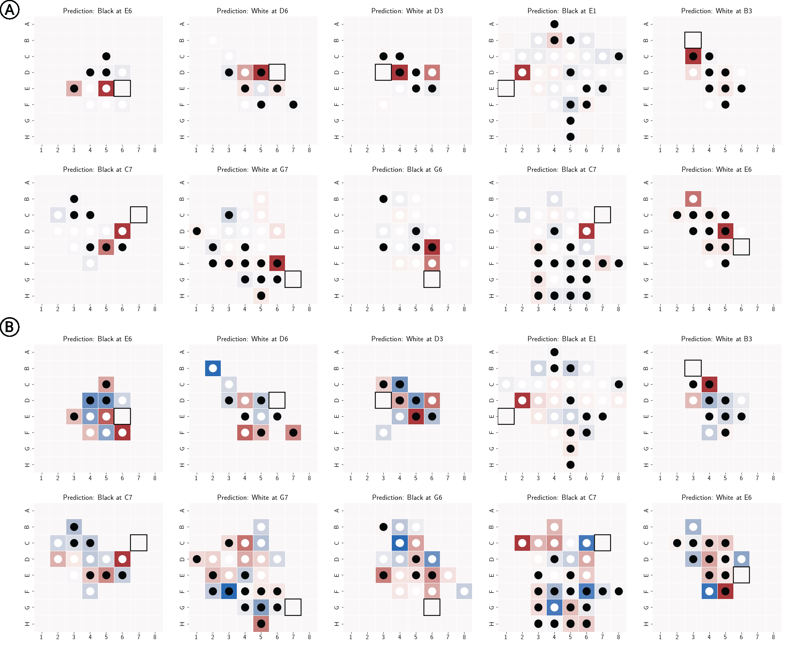

返回 [论文索引](../INDEX.MD) · 插图

# Figure 4. Latent saliency maps

A black box marks the top-1 predicted tile. Red indicates higher saliency and blue lower saliency, after subtracting the board mean. A tile contributes more when changing its state makes the predicted move less likely. (A) The synthetic model emphasizes legality; (B) the championship model assigns saliency more broadly, consistent with strategic play.

See [attribution via intervention](../results/5-latent-saliency.md) and [limitations](../appendix/e-saliency-limitations.md).
