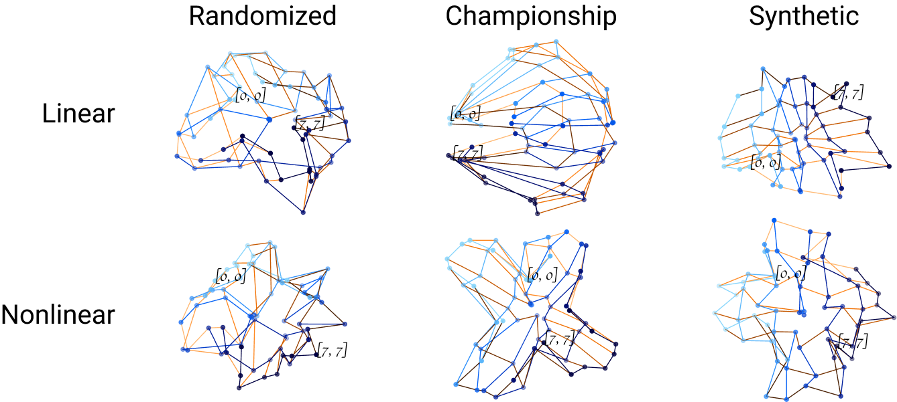

返回 [论文索引](../INDEX.MD) · 插图

# Figure 5. Geometry of probe weights

Top: linear probes. Bottom: second-layer weights of nonlinear probes. Columns: random GPT, championship GPT, and synthetic GPT. Dots are board tiles, adjacent tiles are connected, and the top-left and bottom-right corners are labeled.

See [Appendix A](../appendix/a-probe-geometry.md).
