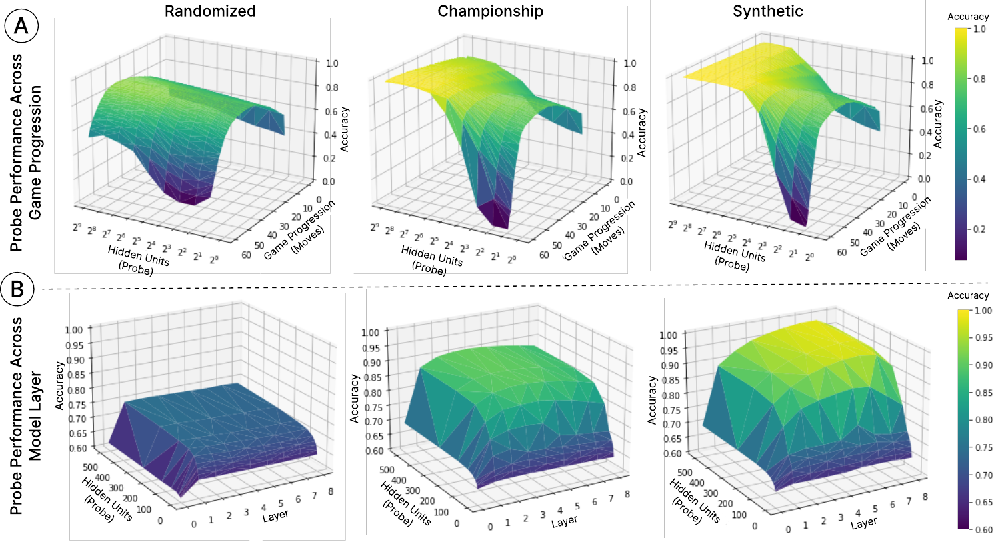

返回 [论文索引](../INDEX.MD) · 插图

# Figure 6. Probe capacity, layer, and game progression

[Original figure (PDF)](../../../TeX/Othello-GPT/arXiv-2210.13382v5/figs/whw.pdf)

(A) Probe accuracy across game progression. (B) Probe accuracy across layers. The plots compare random initialization, championship training, and synthetic training, while varying nonlinear-probe capacity.

See [Appendix B](../appendix/b-probe-capacity.md) and [nonlinear probes](../results/3-nonlinear-probes.md).
