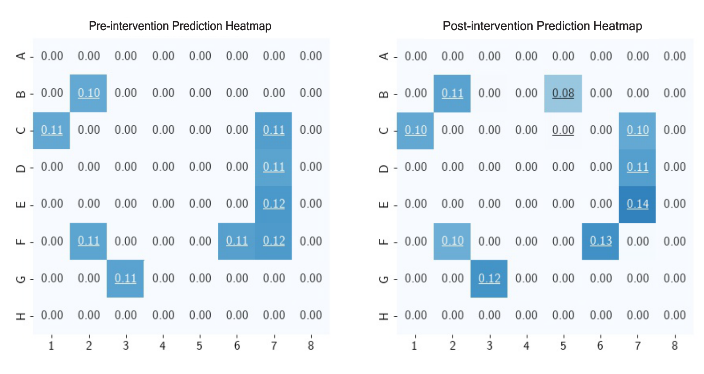

返回 [论文索引](../INDEX.MD) · 插图

# Figure 7. Counterfactual move probability heatmaps

[Original figure (PDF)](../../../TeX/Othello-GPT/arXiv-2210.13382v5/figs/AppendixA_101.pdf)

Synthetic Othello-GPT with a nonlinear intervention. Legal moves for each board are underlined; the left and right panels are before and after the edit respectively.

See [Appendix C](../appendix/c-counterfactual-heatmaps.md).
